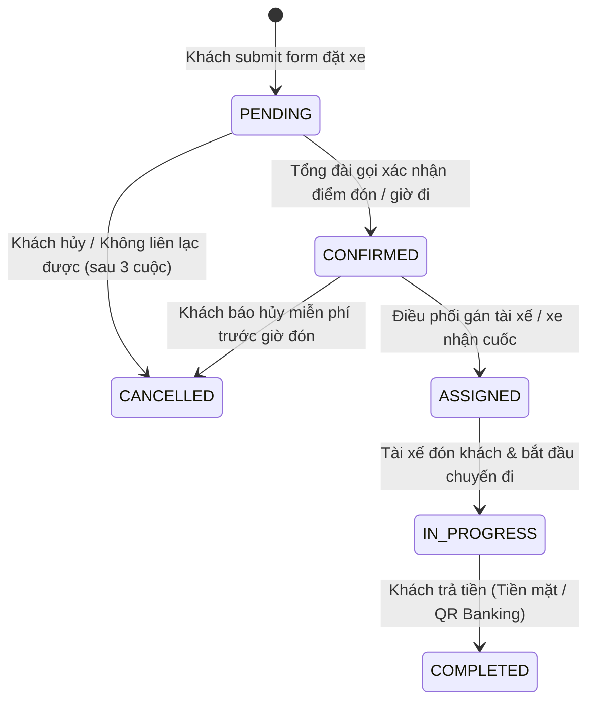
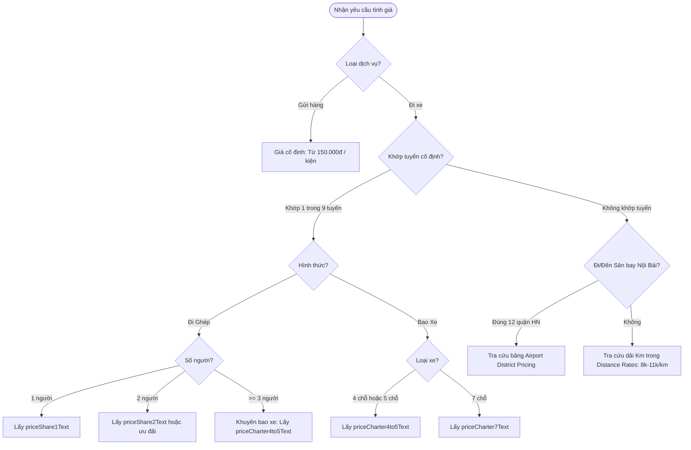
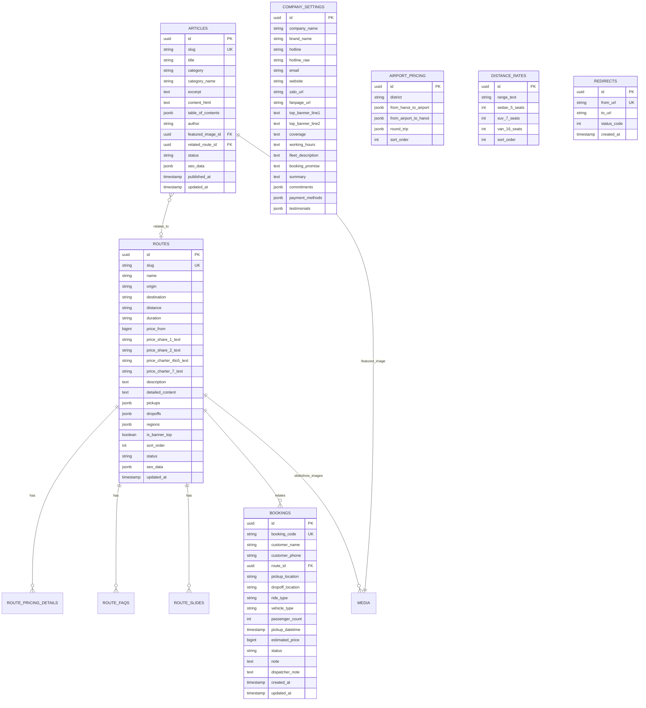

# 📘 TÀI LIỆU ĐẶC TẢ CHI TIẾT HỆ THỐNG HEADLESS CMS, BACKEND & CHIẾN LƯỢC QUẢN LÝ SEO
## DỰ ÁN: NỀN TẢNG ĐIỀU HÀNH & ĐẶT XE GHÉP LIÊN TỈNH (`xegheplientinh.vn`)
> **Phiên bản:** 1.0.0 — Cập nhật: 2026-10-09  
> **Dành cho:** Fullstack Developer, Backend Developer, Frontend Developer & SEO Specialist.

---

## 📑 MỤC LỤC
1. [TỔNG QUAN HỆ THỐNG & MỤC TIÊU KINH DOANH](#1-tổng-quan-hệ-thống--mục-tiêu-kinh-doanh)
2. [CHIẾN LƯỢC QUẢN LÝ SEO TOÀN DIỆN (SEO STRATEGY)](#2-chiến-lược-quản-lý-seo-toàn-diện-seo-strategy)
   - 2.1. Phân định: CMS Quản lý vs Code Tự động hóa
   - 2.2. Nhóm trường SEO chuẩn (Reusable SEO Group)
   - 2.3. Tự động hóa Schema.org Structured Data
   - 2.4. Quản lý Chuyển hướng 301 (Redirects Engine)
   - 2.5. Sitemap & Robots.txt động
3. [ĐẶC TẢ NGHIỆP VỤ KINH DOANH (BUSINESS LOGIC)](#3-đặc-tả-nghiệp-vụ-kinh-doanh-business-logic)
   - 3.1. Vòng đời đơn đặt xe (Booking Workflow & State Machine)
   - 3.2. Động cơ tính giá cước thời gian thực (Pricing Engine)
   - 3.3. Thông báo tức thì cho Điều hành (Instant Notification Flow)
4. [MÔ HÌNH DỮ LIỆU & DATABASE SCHEMA](#4-mô-hình-dữ-liệu--database-schema)
   - 4.1. Sơ đồ quan hệ thực thể (ERD)
   - 4.2. Chi tiết các Collections & Globals
5. [ĐẶC TẢ CHI TIẾT CÁC ENDPOINT API (RESTFUL SPECIFICATION)](#5-đặc-tả-chi-tiết-các-endpoint-api-restful-specification)
   - 5.1. Nhóm API Đặt xe & Báo giá (Booking & Pricing)
   - 5.2. Nhóm API Tuyến đường & Điểm đón trả (Routes)
   - 5.3. Nhóm API Tin tức & Nội dung (Articles)
   - 5.4. Nhóm API Cấu hình chung & Bảng giá phụ (Settings & Auxiliary Rates)
   - 5.5. Nhóm API Webhook & ISR Revalidation
6. [CƠ CHẾ CACHING & HIỆU NĂNG (CORE WEB VITALS)](#6-cơ-chế-caching--hiệu-năng-core-web-vitals)
7. [CHECKLIST NGHIỆM THU & BÀN GIAO (GO-LIVE CHECKLIST)](#7-checklist-nghiệm-thu--bàn-giao-go-live-checklist)

---

## 1. TỔNG QUAN HỆ THỐNG & MỤC TIÊU KINH DOANH

### 1.1. Bối cảnh & Mục tiêu
- **Website hiện tại:** Phát triển trên **Next.js 15 (App Router)**, Tailwind CSS, tối ưu hiệu năng đạt chuẩn Core Web Vitals (LCP < 2.5s, CLS < 0.1).
- **Vấn đề tồn tại:** Toàn bộ dữ liệu bảng giá, 9 tuyến liên tỉnh, tin tức, thông tin công ty đang hardcode trong thư mục `src/data/`. Mỗi khi thay đổi giá xăng dầu, chính sách hoặc thêm tuyến mới, dev phải sửa code và deploy lại.
- **Mục tiêu hệ thống mới:**
  1. Xây dựng **Headless CMS** (khuyến nghị **Payload CMS 3.x** chạy trực tiếp trong Next.js App Router hoặc backend Node.js riêng biệt) giúp người vận hành (không biết code) tự chủ 100% việc cập nhật giá, quản lý tuyến xe, biên tập bài viết.
  2. Xây dựng **Booking Backend Engine**: Tiếp nhận đơn đặt xe, sinh mã vé, tính cước tự động, bắn thông báo tức thì về Telegram/Zalo cho tổng đài viên điều xe.
  3. **Bảo toàn và nâng cao năng lực SEO**: Không để việc chuyển đổi CMS làm mất thứ hạng Google; cung cấp công cụ tối ưu SEO On-page linh hoạt cho đội ngũ Marketing.

---

## 2. CHIẾN LƯỢC QUẢN LÝ SEO TOÀN DIỆN (SEO STRATEGY)

Trong ngành vận tải hành khách (xe ghép, xe tiện chuyến), **SEO là huyết mạch kinh doanh**. Vì vậy, kiến trúc CMS phải phục vụ SEO theo nguyên tắc: **Linh hoạt cho Marketer nhưng Tuyệt đối an toàn về mặt kỹ thuật**.

### 2.1. Phân định: CMS Quản lý vs Code Tự động hóa

```
┌────────────────────────────────────────────────────────┐
│                   PHÂN ĐỊNH TRÁCH NHIỆM SEO            │
├────────────────────────────┬───────────────────────────┤
│    CMS QUẢN LÝ (Admin)     │    CODE TỰ ĐỘNG (Engine)  │
│ (Cho phép Marketer can thiệp)│ (Bảo vệ tính toàn vẹn SEO)│
├────────────────────────────┼───────────────────────────┤
│ • Meta Title tùy biến      │ • Canonical URL chuẩn     │
│ • Meta Description cuốn hút│ • Schema.org JSON-LD      │
│ • Ảnh chia sẻ Zalo/Facebook│ • Dynamic Sitemap.xml     │
│ • Bật/tắt Noindex trang con│ • HTML Semantic & Heading │
│ • Quản lý 301 Redirects    │ • Tự động nén WebP/AVIF   │
│ • Alt Text cho từng ảnh    │ • Tự động sinh Slug bỏ dấu│
└────────────────────────────┴───────────────────────────┘
```

---

### 2.2. Nhóm trường SEO chuẩn (Reusable SEO Group)
Tất cả các thực thể có trang chi tiết công khai (`routes`, `articles`, `policy_pages`) bắt buộc tích hợp nhóm trường SEO sau trong CMS:

```typescript
// Cấu hình Schema SEO Group cho CMS
export const seoFieldGroup = {
  name: 'seo',
  label: 'Tối ưu hóa tìm kiếm (SEO & Social)',
  type: 'group',
  fields: [
    {
      name: 'metaTitle',
      label: 'Tiêu đề SEO tùy biến (Meta Title)',
      type: 'text',
      maxLength: 70,
      admin: {
        description: 'Độ dài tối ưu 50 - 60 ký tự. Nếu để trống, hệ thống tự động sinh theo mẫu: {Tên} | Xe Ghép Liên Tỉnh',
      },
    },
    {
      name: 'metaDescription',
      label: 'Mô tả SEO tùy biến (Meta Description)',
      type: 'textarea',
      maxLength: 160,
      admin: {
        description: 'Độ dài tối ưu 120 - 155 ký tự để kích thích khách bấm vào trên Google. Nếu trống, tự lấy từ tóm tắt.',
      },
    },
    {
      name: 'ogImage',
      label: 'Ảnh đại diện khi chia sẻ MXH (Zalo / Facebook)',
      type: 'upload',
      relationTo: 'media',
      admin: {
        description: 'Kích thước chuẩn 1200x630px. Nếu trống, hệ thống sẽ lấy ảnh mặc định của trang.',
      },
    },
    {
      name: 'noindex',
      label: 'Chặn Google lập chỉ mục (noindex)',
      type: 'checkbox',
      defaultValue: false,
      admin: {
        description: 'Bật tùy chọn này nếu trang đang chạy thử nghiệm hoặc không muốn xuất hiện trên Google.',
      },
    },
  ],
};
```

---

### 2.3. Tự động hóa Schema.org Structured Data
Để đảm bảo **không bao giờ vi phạm chính sách của Google (Manual Action)**, Schema.org bắt buộc được **Code tự sinh từ dữ liệu thật**, Admin không cần nhập code JSON-LD thủ công:

1. **Trang Tuyến xe (`/tuyen-lien-tinh/[slug]`):**
   - Tự động sinh schema `Service` và `Offer`.
   - `price`: Lấy từ trường `priceFrom` thực tế (ví dụ: `400000`).
   - `priceCurrency`: Luôn là `VND`.
   - `areaServed`: Tự động map từ mảng `origin` và `destination`.
2. **Trang Tin tức (`/tin-tuc/[slug]`):**
   - Tự động sinh schema `Article`.
   - `headline`: Lấy từ `article.title`.
   - `datePublished`, `dateModified`: Lấy tự động từ timestamp của bài viết.
   - `author`: Map từ trường tác giả trên CMS.
3. **Toàn trang (Root Layout):**
   - Sinh schema `@graph` gồm `Organization`, `TaxiService`, `WebSite` với Hotline `0962.298.293` và giờ mở cửa `Mo-Su 00:00-24:00`.
4. **Breadcrumbs:**
   - Tự động sinh schema `BreadcrumbList` từ URL hierarchy của trang.

---

### 2.4. Quản lý Chuyển hướng 301 (Redirects Engine)
Khi nhân viên quản trị sửa Slug của một Tuyến xe hoặc Bài viết:
1. CMS tự động lưu 1 bản ghi vào bảng `redirects`:
   - `from`: URL cũ (ví dụ: `/tuyen-lien-tinh/hai-phong-mong-cai`)
   - `to`: URL mới (ví dụ: `/tuyen-lien-tinh/xe-ghep-hai-phong-mong-cai`)
   - `type`: `301` (Permanent Redirect).
2. Khi người dùng hoặc Googlebot truy cập URL cũ, Backend/Middleware lập tức trả về HTTP Status `301 Moved Permanently`. Điều này giúp giữ vững 100% Backlink và độ uy tín (PageRank) của link cũ.

---

### 2.5. Sitemap & Robots.txt động
- **Robots.txt (`/robots.txt`):**
  - Mặc định cho phép crawl toàn trang (`Allow: /`).
  - Chặn trang cảm ơn sau đặt xe (`Disallow: /dat-xe/thanh-cong`).
  - Chặn toàn bộ khu vực quản trị CMS (`Disallow: /admin`).
  - Trỏ link sitemap: `Sitemap: https://xegheplientinh.vn/sitemap.xml`.
- **Sitemap.xml (`/sitemap.xml`):**
  - Không hardcode tĩnh; Backend cung cấp API hoặc Next.js dynamic query database:
  - Tự động lấy tất cả các tuyến có trạng thái `status: 'active'`.
  - Tự động lấy tất cả các bài viết `status: 'published'`.
  - Tự động cập nhật thẻ `<lastmod>` theo ngày sửa đổi gần nhất (`updatedAt`).

---

## 3. ĐẶC TẢ NGHIỆP VỤ KINH DOANH (BUSINESS LOGIC)

### 3.1. Vòng đời đơn đặt xe (Booking Workflow & State Machine)



#### Quy tắc kinh doanh đơn đặt xe:
1. **Mã đặt chỗ duy nhất (Booking Code):**
   - Cấu trúc: `XG-{YYMMDD}-{RANDOM_4_CHARS}` (Ví dụ: `XG-261010-8869`).
   - Sử dụng cho khách tra cứu tại trang `/dat-xe/thanh-cong` và định danh trên hệ thống điều hành.
2. **Cam kết số lượng khách ghép:**
   - Mỗi chuyến xe ghép chỉ nhận từ **1 đến 3 khách/xe 5-7 chỗ**. Tuyệt đối không nhận khách thứ 4 để giữ xe thông thoáng, không mùi.
3. **Quy định đổi / hủy chuyến:**
   - Khách được hủy miễn phí trước giờ xuất phát 30 phút.
   - Không bắt buộc đặt cọc trước đối với cuốc xe ghép thông thường; thu tiền sau chuyến.

---

### 3.2. Động cơ tính giá cước thời gian thực (Pricing Engine)

Thuật toán tính giá trên Backend được chuẩn hóa theo bảng sau:



#### Chi tiết bảng đơn giá:
1. **Gửi hàng hỏa tốc (`guihang`):**
   - Giá từ **150.000đ** / kiện hàng. Giao nhận tận tay 2 đầu trong 2–4 giờ.
2. **Đi ghép (`ghep`):**
   - 1 người: Lấy theo `priceShare1Text` (ví dụ: Hải Phòng - Hà Nội là 400.000đ).
   - 2 người: Lấy theo `priceShare2Text` (ví dụ: Hải Phòng - Hà Nội là 700.000đ).
   - $\ge$ 3 người: Tự động khuyên bao xe và áp dụng giá bao trọn gói `priceCharter4to5Text` để khách vừa riêng tư vừa tiết kiệm.
3. **Bao xe riêng (`bao`):**
   - Xe 4/5 chỗ: Lấy theo `priceCharter4to5Text` (đã gồm vé BOT cao tốc).
   - Xe 7 chỗ: Lấy theo `priceCharter7Text` (đã gồm vé BOT cao tốc).
4. **Tuyến đường dài tùy chọn (Custom Route):**
   - Tra cứu bảng `distance_rates`:
     - Dưới 30 km: 11.000đ/km (5 chỗ), 13.000đ/km (7 chỗ).
     - 31 – 100 km: 9.500đ/km (5 chỗ), 11.500đ/km (7 chỗ).
     - 101 – 200 km: 8.500đ/km (5 chỗ), 10.500đ/km (7 chỗ).
     - Trên 200 km: 8.000đ/km (5 chỗ), 9.500đ/km (7 chỗ).
5. **Đón tiễn Sân bay Nội Bài:**
   - Tra cứu theo 12 quận nội thành Hà Nội (dao động 180.000đ – 280.000đ/chiều tùy quận và dòng xe).

---

### 3.3. Thông báo tức thì cho Điều hành (Instant Notification Flow)
Khi khách gửi đơn đặt xe thành công tại API `POST /api/v1/bookings`:
1. Lưu bản ghi vào PostgreSQL ở trạng thái `status: 'pending'`.
2. Ngay lập tức gọi Worker kích hoạt **Telegram Bot Webhook** đẩy tin nhắn vào Group Điều hành Tổng đài:

```markdown
🚨 **CÓ ĐƠN ĐẶT XE MỚI - MÃ: XG-261010-8869**
━━━━━━━━━━━━━━━━━━━━━━
👤 **Khách hàng:** Nguyễn Tuấn Anh
📞 **Số điện thoại:** [0962298293](tel:0962298293)
🛣 **Tuyến đường:** Hải Phòng ⇄ Hà Nội ⇄ Sân bay Nội Bài
📍 **Điểm đón:** Quán Toan, Hồng Bàng, Hải Phòng
🏁 **Điểm đến:** Sảnh T1 Sân bay Nội Bài
⏰ **Giờ đón:** 08:30 ngày 10/10/2026
🚗 **Hình thức:** Đi Ghép (1 khách) - Xe 5 chỗ
💵 **Giá tạm tính:** 400.000đ
📝 **Ghi chú:** Bay chuyến 11h20 trưa, có 1 vali kéo nhỏ
━━━━━━━━━━━━━━━━━━━━━━
👉 *Bấm vào đây để phân xe: https://admin.xegheplientinh.vn/bookings/XG-261010-8869*
```

---

## 4. MÔ HÌNH DỮ LIỆU & DATABASE SCHEMA

### 4.1. Sơ đồ quan hệ thực thể (ERD)



---

## 5. ĐẶC TẢ CHI TIẾT CÁC ENDPOINT API (RESTFUL SPECIFICATION)

- **Base URL:** `https://xegheplientinh.vn/api/v1`
- **Quy chuẩn mã hóa:** UTF-8, JSON, UTC+07.

---

### 5.1. Nhóm API Đặt xe & Báo giá (Booking & Pricing)

#### ① `POST /api/v1/bookings` — Tiếp nhận đơn đặt xe
- **Mục đích:** Lưu thông tin đặt chỗ của khách từ form website vào database và kích hoạt dispatch notification.
- **Quyền:** Public. Rate limit: `5 requests / phút / IP`.

**Request Body:**
```json
{
  "customerName": "Nguyễn Tuấn Anh",
  "customerPhone": "0962298293",
  "routeSlug": "hai-phong-ha-noi-noi-bai",
  "pickupLocation": "Quán Toan, Hồng Bàng, Hải Phòng",
  "dropoffLocation": "Sảnh T1 Sân bay Nội Bài",
  "rideType": "ghep",
  "vehicleType": "4cho",
  "passengerCount": 1,
  "pickupDateTime": "2026-10-10T08:30:00+07:00",
  "note": "Bay chuyến 11h20 trưa, có 1 vali kéo nhỏ"
}
```

**Validation Schema:**
- `customerName`: Bắt buộc, `string (2..100)`.
- `customerPhone`: Bắt buộc, Regex chuẩn VN: `^(03|05|07|08|09)\d{8}$`.
- `pickupLocation`, `dropoffLocation`: Bắt buộc, `string (3..255)`.
- `rideType`: Bắt buộc, Enum: `["ghep", "bao"]`.
- `vehicleType`: Bắt buộc, Enum: `["4cho", "5cho", "7cho", "guihang"]`.
- `passengerCount`: Số nguyên `1..3` (nếu đi ghép).
- `pickupDateTime`: ISO 8601, thời gian đón phải lớn hơn hiện tại tối thiểu 15 phút.

**Response (`201 Created`):**
```json
{
  "success": true,
  "statusCode": 201,
  "message": "Đặt xe thành công. Tổng đài viên sẽ gọi lại trong ít phút.",
  "data": {
    "bookingCode": "XG-261010-8869",
    "customerName": "Nguyễn Tuấn Anh",
    "customerPhone": "0962298293",
    "route": {
      "slug": "hai-phong-ha-noi-noi-bai",
      "name": "Hải Phòng ⇄ Hà Nội ⇄ Nội Bài"
    },
    "pickupLocation": "Quán Toan, Hồng Bàng, Hải Phòng",
    "dropoffLocation": "Sảnh T1 Sân bay Nội Bài",
    "rideType": "ghep",
    "vehicleType": "4cho",
    "passengerCount": 1,
    "pickupDateTime": "2026-10-10T08:30:00+07:00",
    "estimatedPrice": 400000,
    "estimatedPriceFormatted": "400.000đ",
    "priceNote": "Đón trả tận nhà 2 chiều • Ghép tối đa 1–3 người trên xe, không nhồi nhét.",
    "status": "pending",
    "createdAt": "2026-10-09T11:00:00+07:00"
  }
}
```

---

#### ② `POST /api/v1/pricing/estimate` — Tính cước realtime
- **Mục đích:** Trả về giá tạm tính và badge ưu đãi khi khách chọn điểm đón/trả trên form.

**Request Body:**
```json
{
  "pickup": "Hải Phòng",
  "dropoff": "Bắc Ninh",
  "routeSlug": "hai-phong-bac-ninh-bac-giang",
  "rideType": "ghep",
  "vehicleType": "4cho",
  "passengerCount": 2
}
```

**Response (`200 OK`):**
```json
{
  "success": true,
  "statusCode": 200,
  "message": "Tính giá cước thành công",
  "data": {
    "matchedRoute": {
      "slug": "hai-phong-bac-ninh-bac-giang",
      "name": "Hải Phòng ⇄ Bắc Ninh ⇄ Bắc Giang"
    },
    "estimatedPrice": 700000,
    "displayPrice": "từ 700.000đ",
    "unit": "/ 2 khách",
    "badge": "Ưu đãi đi 2 người",
    "note": "Đón trả tận nhà 2 chiều • Ghép tối đa 1–3 người trên xe, không nhồi nhét."
  }
}
```

---

#### ③ `GET /api/v1/bookings/:code` — Tra cứu vé
- **Mục đích:** Phục vụ trang `/dat-xe/thanh-cong?code=XG-261010-8869`.

**Response (`200 OK`):**
```json
{
  "success": true,
  "statusCode": 200,
  "message": "Tra cứu đơn đặt xe thành công",
  "data": {
    "bookingCode": "XG-261010-8869",
    "customerName": "Nguyễn Tuấn Anh",
    "customerPhoneMasked": "0962***293",
    "pickupLocation": "Quán Toan, Hồng Bàng, Hải Phòng",
    "dropoffLocation": "Sảnh T1 Sân bay Nội Bài",
    "pickupDateTime": "2026-10-10T08:30:00+07:00",
    "rideType": "ghep",
    "vehicleType": "4cho",
    "passengerCount": 1,
    "estimatedPrice": 400000,
    "status": "confirmed"
  }
}
```

---

### 5.2. Nhóm API Tuyến đường & Điểm đón trả (Routes)

#### ① `GET /api/v1/routes` — Danh sách tuyến xe
- **Query Params:**
  - `status`: `"active"` (mặc định)
  - `isBannerTop`: `true` | `false`
  - `region`: `"Hải Phòng"`, `"Hà Nội"`,...

**Response (`200 OK`):**
```json
{
  "success": true,
  "statusCode": 200,
  "message": "Lấy danh sách tuyến xe thành công",
  "data": [
    {
      "id": "c1f7b029-7981-4b13-90d5-b6d85a19812a",
      "slug": "hai-phong-ha-noi-noi-bai",
      "name": "Hải Phòng ⇄ Hà Nội ⇄ Nội Bài",
      "origin": "Hải Phòng",
      "destination": "Hà Nội / Nội Bài",
      "distance": "120 - 145 km",
      "duration": "1 giờ 30 phút",
      "priceFrom": 400000,
      "priceShare1Text": "400k",
      "priceCharter4to5Text": "từ 899k",
      "regions": ["Hải Phòng", "Hà Nội"],
      "isBannerTop": true,
      "sortOrder": 1,
      "thumbnailUrl": "/NoiBai.webp"
    }
  ],
  "meta": { "totalDocs": 9 }
}
```

---

#### ② `GET /api/v1/routes/:slug` — Chi tiết tuyến xe (kèm SEO)
- **Mục đích:** Server-rendered cho trang `src/app/tuyen-lien-tinh/[slug]/page.tsx`.

**Response (`200 OK`):**
```json
{
  "success": true,
  "statusCode": 200,
  "message": "Lấy chi tiết tuyến xe thành công",
  "data": {
    "slug": "hai-phong-ha-noi-noi-bai",
    "name": "Hải Phòng ⇄ Hà Nội ⇄ Nội Bài",
    "origin": "Hải Phòng",
    "destination": "Hà Nội / Nội Bài",
    "distance": "120 - 145 km",
    "duration": "1 giờ 30 phút",
    "priceFrom": 400000,
    "priceShare1Text": "400k",
    "priceShare2Text": "700k",
    "priceCharter4to5Text": "từ 899k",
    "priceCharter7Text": "từ 999k",
    "pricingDetails": [
      { "label": "Ghép 1 người", "price": "400k" },
      { "label": "Ghép 2 người", "price": "700k" },
      { "label": "Bao xe 5 chỗ", "price": "từ 899k" },
      { "label": "Bao xe 7 chỗ", "price": "từ 999k" }
    ],
    "description": "Dịch vụ xe ghép và xe tiện chuyến Hải Phòng ⇄ Hà Nội ⇄ Sân bay Nội Bài chạy cao tốc 5B...",
    "pickups": ["Quán Toan", "Hồng Bàng", "Lê Chân", "Ngô Quyền", "Thủy Nguyên"],
    "dropoffs": ["Các quận nội thành Hà Nội", "Sảnh T1 & T2 Sân bay Nội Bài"],
    "faqs": [
      {
        "question": "Xe có lên sảnh sân bay đón đúng giờ không?",
        "answer": "Có, tài xế theo dõi lịch bay đón đúng sảnh T1 hoặc T2."
      }
    ],
    "slides": [
      {
        "src": "/HaiPhong.webp",
        "badge": "Điểm đón",
        "caption": "Đón trả tận nơi tại nhà riêng Hải Phòng",
        "alt": "Xe ghép Hải Phòng Hà Nội"
      }
    ],
    "seo": {
      "metaTitle": "Xe Ghép Hải Phòng ⇄ Hà Nội ⇄ Nội Bài - Giá Vé Từ 400k Đón Tận Nhà",
      "metaDescription": "Xe ghép tiện chuyến Hải Phòng đi Hà Nội và Sân bay Nội Bài trọn gói từ 400k. Xe 100% đời mới, chạy cao tốc 5B không bắt khách.",
      "ogImageUrl": "https://xegheplientinh.vn/NoiBai.webp",
      "noindex": false
    }
  }
}
```

---

### 5.3. Nhóm API Tin tức & Nội dung (Articles)

#### ① `GET /api/v1/articles` — Danh sách bài viết
- **Query Params:** `page`, `limit`, `category`.

#### ② `GET /api/v1/articles/:slug` — Chi tiết bài viết
- Trả về tiêu đề, ngày đăng, ngày sửa đổi, HTML nội dung sạch, mục lục `tableOfContents`, và nhóm SEO tags.

---

### 5.4. Nhóm API Cấu hình chung & Bảng giá phụ (Settings & Auxiliary Rates)

#### ① `GET /api/v1/settings/company`
- Trả về thông tin hotline, thương hiệu, fanpage, cam kết chất lượng, phương thức thanh toán, đánh giá 5 sao.

#### ② `GET /api/v1/pricing/airport`
- Trả về bảng giá chi tiết đón tiễn sân bay Nội Bài theo 12 quận nội thành Hà Nội (chiều đi, chiều về, khứ hồi).

#### ③ `GET /api/v1/pricing/distance`
- Trả về biểu giá tính cước theo kilômét và các chính sách giảm giá khứ hồi, giờ chờ, lưu đêm.

---

### 5.5. Nhóm API Webhook & ISR Revalidation

#### `POST /api/v1/webhooks/revalidate`
- **Mục đích:** Khi biên tập viên lưu/publish bất kỳ bài viết hoặc tuyến xe nào trên CMS, CMS tự động gửi webhook gọi Next.js On-Demand ISR để xóa cache.
- **Headers:** `x-revalidate-secret: <SECRET_KEY>`
- **Body:**
```json
{
  "collection": "routes",
  "slug": "hai-phong-ha-noi-noi-bai",
  "action": "update"
}
```
- **Hành động phía Next.js App Router:**
  - `revalidatePath('/tuyen-lien-tinh/hai-phong-ha-noi-noi-bai')`
  - `revalidatePath('/tuyen-lien-tinh')`
  - `revalidatePath('/')`
  - `revalidatePath('/sitemap.xml')`

---

## 6. CƠ CHẾ CACHING & HIỆU NĂNG (CORE WEB VITALS)

Để đảm bảo điểm Google PageSpeed đạt $\ge 90$ và Core Web Vitals loại Tốt:

1. **Client Request:** Đi qua CDN (Cloudflare) -> Vercel Edge Network.
2. **Trang Tĩnh với ISR:**
   - Các trang Tuyến đường và Bài viết dùng **Static Generation (SSG)** kết hợp **Incremental Static Regeneration (ISR)** với thời gian `revalidate: 60` giây.
   - Khi có thay đổi từ CMS, webhook revalidation lập tức xóa cache trang đó trên CDN.
3. **Media Pipeline:**
   - Toàn bộ hình ảnh tải lên CMS tự động được Sharp nén sang định dạng **WebP** và **AVIF** với kích thước intrinsic rõ ràng (`width`, `height`) để loại bỏ hoàn toàn hiện tượng layout shift (CLS = 0).
4. **Database Connection Pooling:**
   - Dùng PgBouncer (Neon / Supabase) để xử lý hàng ngàn lượt khách tra cước cùng lúc mà không bị nghẽn kết nối database.

---

## 7. CHECKLIST NGHIỆM THU & BÀN GIAO (GO-LIVE CHECKLIST)

Đội ngũ phát triển Backend & SEO cần kiểm tra từng mục trước khi đưa hệ thống vào vận hành chính thức:

- [ ] **Mô hình Dữ liệu:** Đã tạo đủ 10 Collections/Globals trên CMS và seed dữ liệu từ `src/data/`.
- [ ] **Booking Flow:** Form đặt xe gửi dữ liệu thành công -> Lưu DB -> Bắn tin nhắn Telegram tức thì.
- [ ] **Pricing Engine:** Tính cước chính xác theo từng trường hợp (1 khách, 2 khách, bao xe, gửi hàng, tính theo km).
- [ ] **SEO Meta Tags:** Kiểm tra thẻ `<title>`, `<meta name="description">`, `<link rel="canonical">` khớp 100% từng trang.
- [ ] **Schema.org:** Test Google Rich Results Test vượt qua cho cả `TaxiService` và `Article`.
- [ ] **Redirect Engine:** Đổi slug một tuyến thử nghiệm -> Kiểm tra trả về đúng mã HTTP `301`.
- [ ] **Bảo mật Admin:** Trang `/admin` có mã bảo vệ, header `X-Robots-Tag: noindex, nofollow`, chặn Googlebot index.
- [ ] **Sitemap.xml:** Truy cập `https://xegheplientinh.vn/sitemap.xml` thấy danh sách đầy đủ 9 tuyến và các bài viết.
- [ ] **Core Web Vitals:** Mobile LCP $\le 2.5s$, CLS $\le 0.1$, INP $\le 200ms$.

---
*Tài liệu được thiết kế nhằm chuẩn hóa toàn bộ kiến trúc Backend và bảo tồn năng lực SEO cho website Xe Ghép Liên Tỉnh.*
