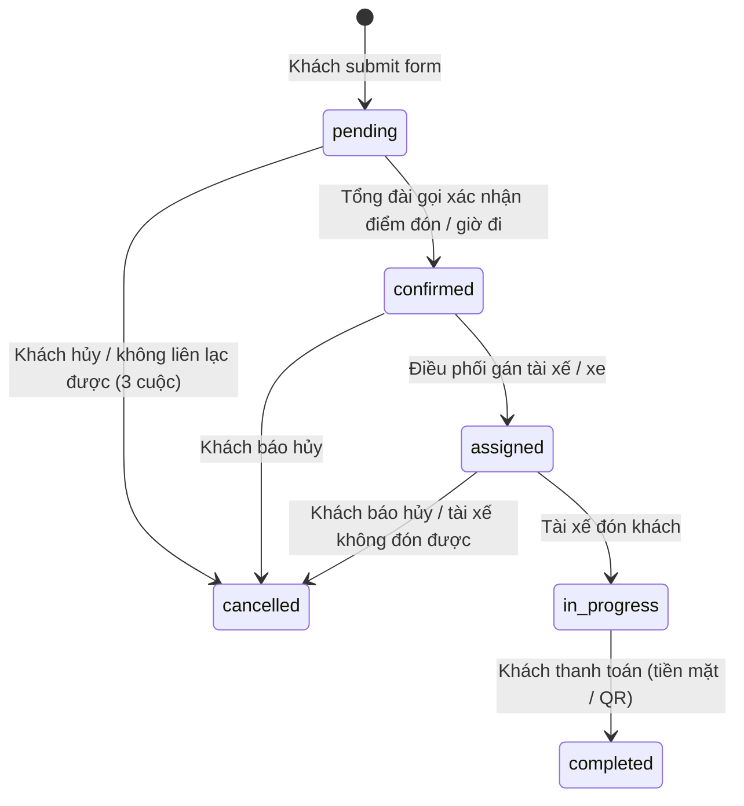
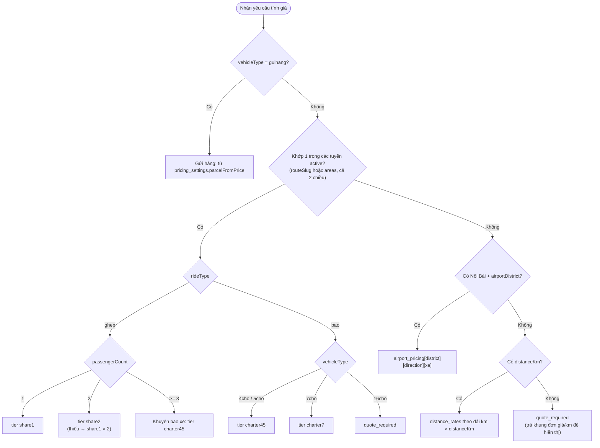
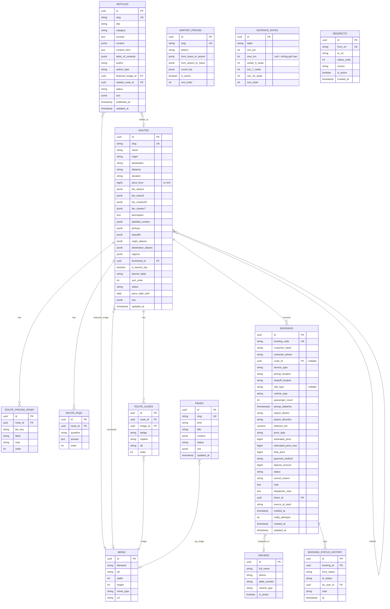

# 📘 TÀI LIỆU ĐẶC TẢ CHI TIẾT HỆ THỐNG HEADLESS CMS, BACKEND & CHIẾN LƯỢC QUẢN LÝ SEO
## DỰ ÁN: NỀN TẢNG ĐIỀU HÀNH & ĐẶT XE GHÉP LIÊN TỈNH (`xegheplientinh.vn`)
> **Phiên bản:** 1.1.0 — Cập nhật: 2026-10-09
> **Thay thế:** 1.0.0 (cùng ngày). Bản này bổ sung các phần còn thiếu so với frontend `TestSEO` (Next.js 15).
> **Dành cho:** Fullstack Developer, Backend Developer, Frontend Developer & SEO Specialist.
> **Quy ước:** `[CẦN CHỐT]` = quyết định nghiệp vụ chưa có, đã ghi giá trị mặc định đề xuất (xem mục 8).

---

## 📑 MỤC LỤC
0. [LỊCH SỬ THAY ĐỔI (1.0.0 → 1.1.0)](#0-lịch-sử-thay-đổi-100--110)
1. [TỔNG QUAN HỆ THỐNG & MỤC TIÊU KINH DOANH](#1-tổng-quan-hệ-thống--mục-tiêu-kinh-doanh)
2. [CHIẾN LƯỢC QUẢN LÝ SEO TOÀN DIỆN](#2-chiến-lược-quản-lý-seo-toàn-diện)
3. [ĐẶC TẢ NGHIỆP VỤ KINH DOANH](#3-đặc-tả-nghiệp-vụ-kinh-doanh)
4. [MÔ HÌNH DỮ LIỆU & DATABASE SCHEMA](#4-mô-hình-dữ-liệu--database-schema)
5. [ĐẶC TẢ CHI TIẾT API](#5-đặc-tả-chi-tiết-api)
6. [CACHING, REVALIDATION & HIỆU NĂNG](#6-caching-revalidation--hiệu-năng)
7. [THAY ĐỔI BẮT BUỘC Ở FRONTEND](#7-thay-đổi-bắt-buộc-ở-frontend)
8. [CÁC ĐIỂM CẦN CHỐT VỚI NGHIỆP VỤ](#8-các-điểm-cần-chốt-với-nghiệp-vụ)
9. [CHECKLIST NGHIỆM THU & BÀN GIAO](#9-checklist-nghiệm-thu--bàn-giao)
- [PHỤ LỤC A — Bộ test case báo giá (golden cases)](#phụ-lục-a--bộ-test-case-báo-giá-golden-cases)
- [PHỤ LỤC B — Ánh xạ `src/data/` → CMS & script seed](#phụ-lục-b--ánh-xạ-srcdata--cms--script-seed)

---

## 0. LỊCH SỬ THAY ĐỔI (1.0.0 → 1.1.0)

| # | Vấn đề ở 1.0.0 | Cách xử lý ở 1.1.0 | Mục |
|---|---|---|---|
| P0-1 | Giá lưu dạng text (`"400k – 500k"`, `"Liên hệ thỏa thuận"`) nên Pricing Engine không thể trả `estimatedPrice` là số; `pricingDetails` độc lập với 4 trường giá | Thêm **PriceTier** (số + cờ `from`/`negotiable`); `pricingDetails` tham chiếu tier; text hiển thị được **sinh tự động** | 3.2, 4.2 |
| P0-2 | Trang tĩnh (home, giới thiệu, liên hệ, listing, đặt xe) và 3 trang chính sách không quản trị được SEO; `policy_pages` chỉ nhắc tên | Thêm collection **`pages`** (SEO cho trang hệ thống + nội dung trang chính sách) | 2.2, 4.2 |
| P0-3 | Contract booking lệch frontend (thiếu `note`, `guihang`, tuyến custom, timezone, phone regex, trang thành công) và `GET /bookings/:code` có thể bị dò mã | Viết lại contract; thêm `lookup token`, rate limit, normalize phone | 3.1, 5.1 |
| P1 | `metaTitle` bị template cộng thêm ` \| Xe Ghép Liên Tỉnh` (+20 ký tự) | Thêm `appendBrand`; validate tổng độ dài | 2.2 |
| P1 | `priceValidUntil` hardcode `2026-12-31` | Chuyển thành field có cảnh báo hết hạn | 2.3, 4.2 |
| P1 | Logo / OG mặc định / `areaServed` / `priceRange` không có nguồn | Bổ sung vào `company_settings` | 4.2 |
| P1 | Trang `noindex` vẫn nằm trong sitemap; sitemap thiếu trang tĩnh; robots thiếu `/api/` | Viết lại quy tắc sitemap/robots | 2.6 |
| P1 | Redirect engine không nói cách chạy (next.config chạy lúc build); 5 redirect cũ chưa được seed | Middleware + endpoint cache; quy tắc chống loop/chain; seed | 2.5 |
| P1 | Revalidation chỉ 4 path, bỏ sót layout (header/footer/hotline), `/tin-tuc`, `/gioi-thieu` | Revalidate theo **tag** + path; mapping đầy đủ | 6 |
| P1 | Chưa nói ảnh CMS host ở đâu; Sharp + next/image xử lý trùng | Chốt pipeline media | 6.3 |
| P2 | Mục lục có 4.2 nhưng không có nội dung; "10 collections" không khớp ERD; bảng con không có định nghĩa | Viết đủ 4.2, thống kê lại: **10 collections + 2 globals** | 4 |
| P2 | `/pricing/distance` hứa trả chính sách khứ hồi/giờ chờ/lưu đêm nhưng không có field | Thêm global **`pricing_settings`** | 4.2, 5.4 |
| P2 | "Gửi hàng từ 150.000đ" hardcode ở nhiều nơi; quy tắc hủy/đặt trước lệch giữa spec và UI | Đưa vào `pricing_settings`; ghi vào mục 8 | 4.2, 8 |
| P2 | Trạng thái ASSIGNED nhưng không có tài xế | Thêm collection **`drivers`** tối giản | 3.1, 4.2 |

---

## 1. TỔNG QUAN HỆ THỐNG & MỤC TIÊU KINH DOANH

### 1.1. Bối cảnh & Mục tiêu
- **Website hiện tại:** Next.js 15 (App Router), Tailwind CSS, tối ưu Core Web Vitals (LCP < 2.5s, CLS < 0.1).
- **Vấn đề tồn tại:** Bảng giá, 9 tuyến liên tỉnh, tin tức, thông tin công ty hardcode trong `src/data/`. Mỗi lần đổi giá/chính sách/tuyến phải sửa code và deploy lại.
- **Mục tiêu hệ thống mới:**
  1. **Headless CMS** (khuyến nghị **Payload CMS 3.x** chạy cùng Next.js App Router, hoặc backend Node.js riêng) để người vận hành (không biết code) tự cập nhật giá, tuyến, bài viết, SEO.
  2. **Booking Backend Engine**: nhận đơn, sinh mã vé, tính cước tự động, báo ngay cho tổng đài qua Telegram.
  3. **Bảo toàn và nâng cao SEO**: chuyển CMS không được làm mất thứ hạng; Marketer tự tối ưu On-page.

### 1.2. Phạm vi
| Giai đoạn | Nội dung |
|---|---|
| **Phase 1 (spec này)** | Routes, Articles, Company/Pricing settings, Airport & Distance rates, Booking + Pricing Engine, Redirects, SEO cho mọi trang, trang chính sách (nội dung CMS) |
| **Phase 2 (tùy chọn)** | Nội dung block cho home / giới thiệu qua `pages.blocks`; trang bảng giá sân bay & theo km; Zalo notification; thanh toán QR |

> Trong Phase 1, **nội dung** các trang home / giới thiệu / liên hệ vẫn nằm trong code; CMS chỉ quản lý **SEO** của chúng (xem 2.2).

---

## 2. CHIẾN LƯỢC QUẢN LÝ SEO TOÀN DIỆN

Nguyên tắc: **Linh hoạt cho Marketer nhưng tuyệt đối an toàn về kỹ thuật.**

### 2.1. Phân định: CMS quản lý vs Code tự động hóa

```
┌────────────────────────────────────────────────────────┐
│                   PHÂN ĐỊNH TRÁCH NHIỆM SEO            │
├────────────────────────────┬───────────────────────────┤
│    CMS QUẢN LÝ (Admin)     │    CODE TỰ ĐỘNG (Engine)  │
├────────────────────────────┼───────────────────────────┤
│ • Meta Title / Description │ • Canonical URL chuẩn     │
│ • Ảnh chia sẻ Zalo/FB      │ • Schema.org JSON-LD      │
│ • Bật/tắt noindex          │ • Dynamic Sitemap.xml     │
│ • Quản lý 301 Redirects    │ • Robots.txt              │
│ • Alt text cho từng ảnh    │ • HTML Semantic & Heading │
│ • SEO cho TRANG TĨNH       │ • Resize/optimize ảnh     │
│ • Hạn hiệu lực giá (Offer) │ • Tự sinh slug bỏ dấu     │
│ • Logo / OG mặc định       │ • BreadcrumbList          │
└────────────────────────────┴───────────────────────────┘
```

### 2.2. Nhóm trường SEO chuẩn (Reusable SEO Group)

Áp dụng cho: `routes`, `articles`, `pages` (gồm trang hệ thống và trang chính sách).

```typescript
export const BRAND_SUFFIX = ' | Xe Ghép Liên Tỉnh' // 20 ký tự, do template layout thêm vào

export const seoFieldGroup = {
  name: 'seo',
  label: 'Tối ưu hóa tìm kiếm (SEO & Social)',
  type: 'group',
  fields: [
    {
      name: 'metaTitle',
      type: 'text',
      label: 'Tiêu đề SEO (Meta Title)',
      maxLength: 70,
      admin: {
        description:
          'Tối ưu 50–60 ký tự TÍNH CẢ hậu tố thương hiệu nếu bật "Tự thêm tên thương hiệu". ' +
          'Để trống: tự sinh theo mẫu "{Tên} | Xe Ghép Liên Tỉnh".',
      },
      validate: (val: string | undefined, { siblingData }: any) => {
        if (!val) return true
        const total = val.length + (siblingData?.appendBrand !== false ? BRAND_SUFFIX.length : 0)
        return total <= 70 || `Tổng độ dài hiển thị ${total} ký tự (> 70). Rút gọn hoặc tắt "Tự thêm tên thương hiệu".`
      },
    },
    {
      name: 'appendBrand',
      type: 'checkbox',
      label: 'Tự thêm " | Xe Ghép Liên Tỉnh" vào cuối title',
      defaultValue: true,
      admin: { description: 'Tắt nếu title đã dài hoặc đã có tên thương hiệu. Khi tắt, frontend dùng title.absolute.' },
    },
    {
      name: 'metaDescription',
      type: 'textarea',
      label: 'Mô tả SEO (Meta Description)',
      maxLength: 160,
      admin: { description: 'Tối ưu 120–155 ký tự. Để trống: lấy từ description/excerpt.' },
    },
    {
      name: 'ogImage',
      type: 'upload',
      relationTo: 'media',
      label: 'Ảnh chia sẻ MXH (Zalo / Facebook) — 1200×630',
      admin: { description: 'Để trống: ảnh đại diện của trang → `company_settings.defaultOgImage`.' },
    },
    {
      name: 'noindex',
      type: 'checkbox',
      label: 'Chặn Google lập chỉ mục (noindex)',
      defaultValue: false,
      admin: { description: 'Trang noindex sẽ tự bị loại khỏi sitemap.xml.' },
    },
  ],
}
```

**Quy tắc sinh metadata (frontend):**
| Quy tắc | Nội dung |
|---|---|
| SEO-1 | `title`: nếu có `metaTitle` → `appendBrand ? metaTitle : { absolute: metaTitle }`; nếu không → `"{name} \| Xe Ghép Liên Tỉnh"`. |
| SEO-2 | `description`: `metaDescription` → `description`/`excerpt` (cắt ≤ 155 ký tự, không cắt giữa từ). |
| SEO-3 | `canonical`: luôn tự sinh `https://xegheplientinh.vn{path}`, **không** cho Admin sửa. |
| SEO-4 | `og:image`: `seo.ogImage` → ảnh đại diện (thumbnail/featuredImage) → `company_settings.defaultOgImage`. Luôn URL tuyệt đối, kích thước 1200×630. |
| SEO-5 | `noindex = true` → `robots: { index:false, follow:false }` **và** loại khỏi sitemap. |
| SEO-6 | Không đặt `alternates.canonical` ở root layout (tránh kế thừa sai). |

**Trang hệ thống (`pages.kind = 'system'`)** — chỉ quản lý SEO, nội dung ở code:

| slug | Đường dẫn | Ghi chú |
|---|---|---|
| `home` | `/` | |
| `gioi-thieu` | `/gioi-thieu` | |
| `lien-he` | `/lien-he` | |
| `tuyen-lien-tinh` | `/tuyen-lien-tinh` | Trang listing |
| `tin-tuc` | `/tin-tuc` | Trang listing |
| `dat-xe` | `/dat-xe` | |

**Trang chính sách (`pages.kind = 'content'`)** — có thêm `content` (richText) + `seo`:
`chinh-sach/bao-mat`, `chinh-sach/dam-bao`, `chinh-sach/thanh-toan`. Trang `dam-bao` và `thanh-toan` vẫn render thêm `commitments` / `paymentMethods` từ `company_settings`.

> Trang `/dat-xe/thanh-cong` **không** nằm trong CMS: luôn `noindex`, luôn `Disallow` trong robots.

### 2.3. Tự động hóa Schema.org Structured Data

Schema được **code tự sinh từ dữ liệu thật**, Admin không nhập JSON-LD.

| Trang | Schema | Nguồn dữ liệu |
|---|---|---|
| Toàn site (root layout) | `@graph`: `Organization`, `TaxiService`, `WebSite` | `company_settings`: `companyName`, `logo`, `hotlineRaw` (→ `+84…`), `workingHours`, `areaServed[]`, `priceRange` |
| `/tuyen-lien-tinh/[slug]` | `Service` + `Offer` | `route.priceFrom` (số), `priceCurrency: "VND"`, `areaServed` từ `origin`/`destination`, `priceValidUntil` |
| `/tin-tuc/[slug]` | `Article` | `title`, `publishedAt`, `updatedAt`, `author`, `featuredImage` |
| Mọi trang con | `BreadcrumbList` | Tự sinh từ cấu trúc URL |

**Quy tắc:**
- **SCH-1 `priceValidUntil`:** lấy `route.priceValidUntil` nếu có, ngược lại `pricing_settings.priceValidUntil`. Nếu ngày này còn **< 30 ngày hoặc đã qua**, dashboard CMS hiện cảnh báo đỏ và Telegram nhắc Marketer. Frontend **không** được hardcode ngày.
- **SCH-2 Offer.price:** chỉ dùng `priceFrom` (số thật). Không bao giờ sinh giá từ text.
- **SCH-3 priceRange:** `company_settings.priceRange` (text). Để trống thì tự tính `"{min priceFrom}đ - {max giá bao xe}đ"`.
- **SCH-4 Hotline:** `telephone` = `+84` + `hotlineRaw` bỏ số 0 đầu.
- **SCH-5 Author:** mặc định `Organization` = `brandName`; cho phép `authorType = Person` khi có tác giả cá nhân.
- Kiểm thử bắt buộc bằng Google Rich Results Test (xem checklist mục 9).

### 2.4. Quản lý slug

- Slug tự sinh từ `name`/`title` bằng `slugify` (bỏ dấu, `đ → d`, chữ thường, `-`). Admin được sửa, phải **duy nhất** trong collection.
- Khi **đã publish/active**, đổi slug sẽ tự tạo redirect (xem 2.5) và hiện hộp xác nhận trong admin.

### 2.5. Quản lý chuyển hướng 301 (Redirects Engine)

**Tạo tự động** (hook `afterChange` của `routes`, `articles`, `pages`) khi `slug` đổi:

```typescript
// payload/hooks/createRedirectOnSlugChange.ts
import type { CollectionAfterChangeHook } from 'payload'

export const createRedirectOnSlugChange =
  (basePath: string): CollectionAfterChangeHook =>
  async ({ doc, previousDoc, operation, req }) => {
    if (operation !== 'update' || !previousDoc?.slug || previousDoc.slug === doc.slug) return doc
    if (previousDoc.status !== 'active' && previousDoc.status !== 'published') return doc // chưa public thì không cần

    const from = `${basePath}/${previousDoc.slug}`
    const to = `${basePath}/${doc.slug}`

    // 1) Gộp chuỗi: mọi redirect đang trỏ tới `from` → trỏ thẳng tới `to`
    await req.payload.update({
      collection: 'redirects',
      where: { toUrl: { equals: from } },
      data: { toUrl: to },
      req,
    })
    // 2) Nếu `to` từng là điểm đi của một redirect cũ (quay lại slug cũ) → xoá để tránh loop
    await req.payload.delete({ collection: 'redirects', where: { fromUrl: { equals: to } }, req })
    // 3) Tạo redirect mới
    await req.payload.create({
      collection: 'redirects',
      data: { fromUrl: from, toUrl: to, statusCode: 301, source: 'auto', isActive: true },
      req,
    })
    return doc
  }
```

**Quy tắc:**
| Mã | Quy tắc |
|---|---|
| RD-1 | `fromUrl` là **path** đã chuẩn hóa: chữ thường, bắt đầu bằng `/`, không có `/` cuối, không query. Duy nhất. |
| RD-2 | `toUrl` là path nội bộ hoặc URL tuyệt đối; không được trùng `fromUrl`. |
| RD-3 | Cấm loop và chuỗi: validate khi lưu (đi theo `toUrl` tối đa 5 bước; gặp lại `fromUrl` → từ chối). |
| RD-4 | `statusCode` ∈ {301, 302, 307, 308, 410}. Mặc định 301. `410` cho nội dung gỡ vĩnh viễn (không có `toUrl`). |
| RD-5 | Tuyến/bài chuyển `inactive`/`draft`/`archived` mà **không** có redirect → trả 404 thật (`notFound()`). |
| RD-6 | **Seed** 5 redirect hiện có trong `next.config.ts` (`/dich-vu-xe-ghep`, `/bang-gia`, `/taxi-dua-don-san-bay-noi-bai`, `/taxi-duong-dai`, `/dang-ky-doi-tac`) với `source: 'seed'`, sau đó **xóa khỏi `next.config.ts`**. |

**Cách thực thi** (`next.config.ts#redirects()` chạy lúc build, không đọc DB được):

```typescript
// middleware.ts
import { NextRequest, NextResponse } from 'next/server'

export const config = {
  matcher: ['/((?!_next/|api/|admin|media/|favicon.ico|robots.txt|sitemap.xml).*)'],
}

type RedirectEntry = { to: string; code: number }
let cache: { at: number; map: Map<string, RedirectEntry> } | null = null
const TTL_MS = 60_000

async function getMap(): Promise<Map<string, RedirectEntry>> {
  if (cache && Date.now() - cache.at < TTL_MS) return cache.map
  try {
    const res = await fetch(`${process.env.CMS_URL}/api/v1/redirects`, { cache: 'no-store' })
    const json = await res.json()
    const map = new Map<string, RedirectEntry>(
      json.data.map((r: any) => [r.from, { to: r.to, code: r.statusCode }]),
    )
    cache = { at: Date.now(), map }
    return map
  } catch {
    return cache?.map ?? new Map() // CMS lỗi → không chặn website
  }
}

export async function middleware(req: NextRequest) {
  const path = req.nextUrl.pathname.replace(/\/+$/, '').toLowerCase() || '/'
  const hit = (await getMap()).get(path)
  if (!hit) return NextResponse.next()
  if (hit.code === 410) return new NextResponse('Gone', { status: 410 })
  const url = new URL(hit.to, req.url)
  url.search = req.nextUrl.search
  return NextResponse.redirect(url, hit.code)
}
```
> Độ trễ tối đa để một redirect mới có hiệu lực = `TTL_MS` (60 giây). Chấp nhận được.

### 2.6. Sitemap & Robots.txt động

**`/sitemap.xml`** — frontend gọi `GET /api/v1/seo/sitemap` (cache tag `sitemap`) và **không hardcode**:

| Nhóm URL | Điều kiện | `lastmod` |
|---|---|---|
| Trang hệ thống (6) + trang chính sách (3) | `pages.status = 'published'` và `seo.noindex = false` | `pages.updatedAt` |
| Tuyến `/tuyen-lien-tinh/{slug}` | `status = 'active'` và `seo.noindex = false` | `routes.updatedAt` |
| Bài `/tin-tuc/{slug}` | `status = 'published'` và `seo.noindex = false` | `articles.updatedAt` |

Không đưa vào sitemap: `/dat-xe/thanh-cong`, `/admin`, `/api`, URL nằm trong bảng `redirects`.
`changefreq` / `priority` là tùy chọn (Google bỏ qua); chỉ `lastmod` có giá trị và phải chính xác.

**`/robots.txt`:**
```
User-agent: *
Allow: /
Disallow: /dat-xe/thanh-cong
Disallow: /admin
Disallow: /api/
Sitemap: https://xegheplientinh.vn/sitemap.xml
```
> Ảnh CMS **không** được phục vụ dưới `/api/…` (nếu không, `Disallow: /api/` sẽ chặn Google Images). Dùng domain/đường dẫn media riêng (xem 6.3).
> `/admin` phải thêm header `X-Robots-Tag: noindex, nofollow` và yêu cầu đăng nhập.

---

## 3. ĐẶC TẢ NGHIỆP VỤ KINH DOANH

### 3.1. Vòng đời đơn đặt xe



**Bảng chuyển trạng thái (bắt buộc validate ở backend):**

| Từ → Đến | Điều kiện bắt buộc | Ai thực hiện |
|---|---|---|
| `pending → confirmed` | — | Dispatcher |
| `confirmed → assigned` | Có `driver` (active) | Dispatcher |
| `assigned → in_progress` | — | Dispatcher/Tài xế |
| `in_progress → completed` | Có `finalPrice`, `paymentMethod` | Dispatcher |
| `* → cancelled` | Có `cancelReason` (enum: `customer_cancel`, `unreachable`, `no_driver`, `other`) | Dispatcher |
| Mọi chuyển khác | Từ chối `409 INVALID_TRANSITION` | — |

Mỗi lần đổi trạng thái ghi vào `statusHistory[]` (`from`, `to`, `by`, `at`, `note`).
Giá trị DB/API dùng **chữ thường** (`pending`…); frontend nhận thêm `statusLabel` tiếng Việt.

#### Quy tắc kinh doanh đơn đặt xe
1. **Mã đặt chỗ:** `XG-{YYMMDD}-{6 ký tự}`, bảng ký tự `23456789ABCDEFGHJKMNPQRSTUVWXYZ` (bỏ `0 O 1 I L`). Ví dụ `XG-261010-K7M2QX`. Sinh bằng CSPRNG; trùng thì sinh lại (tối đa 5 lần).
2. **Số khách ghép:** 1–3 khách/xe 4–7 chỗ; không nhận khách thứ 4. Chọn ≥ 3 khách → hệ thống khuyên bao xe và tính theo giá bao xe 4/5 chỗ (xem 3.2).
3. **Thời gian đặt:** `pickupDateTime` ≥ hiện tại + `pricing_settings.minLeadTimeMinutes` (mặc định **15 phút**) và ≤ hiện tại + 90 ngày. Khuyến nghị trên giao diện "đặt trước 30–60 phút" chỉ là gợi ý, không phải giới hạn cứng.
4. **Hủy/đổi:** miễn phí theo `pricing_settings.freeCancelMinutes` (mặc định **30 phút** trước giờ đón) `[CẦN CHỐT — mục 8]`.
5. **Đặt cọc:** không bắt buộc với đi ghép. Bao xe: `[CẦN CHỐT]` (frontend đang ghi "chuyển khoản khi đặt cọc bao xe"). Trường `depositAmount` để sẵn, mặc định `null`.
6. **Thanh toán:** sau chuyến — `paymentMethod ∈ {cash, transfer}`, ghi nhận khi `completed`.
7. **Giảm 10% khách cũ** (frontend hero): chỉ là nội dung truyền thông, **không** tự áp dụng trong engine. Giá trị lưu ở `pricing_settings.returningCustomerDiscountPercent` để hiển thị.

### 3.2. Động cơ tính giá cước thời gian thực (Pricing Engine)

#### 3.2.1. Mô hình giá: `PriceTier`
Mỗi mức giá của tuyến là một object **số**, text hiển thị được sinh từ nó:

```typescript
type PriceTier = {
  min: number | null        // VND, số nguyên. null khi negotiable
  max: number | null        // null = giá cố định (hoặc "từ …")
  from: boolean             // true → hiển thị "từ {min}"
  negotiable: boolean       // true → "Liên hệ thỏa thuận"
}
```
| Text hiện tại | `PriceTier` |
|---|---|
| `"400k"` | `{ min: 400000, max: null, from: false, negotiable: false }` |
| `"từ 899k"` | `{ min: 899000, max: null, from: true, negotiable: false }` |
| `"400k – 500k"` | `{ min: 400000, max: 500000, from: false, negotiable: false }` |
| `"1.500k – 1.600k"` | `{ min: 1500000, max: 1600000, from: false, negotiable: false }` |
| `"Liên hệ thỏa thuận"` | `{ min: null, max: null, from: false, negotiable: true }` |

Hàm hiển thị dùng chung (backend và frontend):

```typescript
const vnd = (n: number) => `${new Intl.NumberFormat('vi-VN').format(n)}đ` // 400000 → "400.000đ"
const shortK = (n: number) => `${new Intl.NumberFormat('vi-VN').format(n / 1000)}k` // 1500000 → "1.500k"

export function formatTier(t: PriceTier, style: 'short' | 'full' = 'full'): string {
  if (t.negotiable || t.min == null) return 'Liên hệ thỏa thuận'
  const f = style === 'short' ? shortK : vnd
  if (t.max != null) return `${f(t.min)} – ${f(t.max)}`
  return t.from ? `từ ${f(t.min)}` : f(t.min)
}
```
API vẫn trả các trường text cũ (`priceShare1Text`…) = `formatTier(tier, 'short')` để frontend chạy tương thích.

**Quy tắc nhất quán:**
- `route.priceFrom` = **tự tính** = `min` nhỏ nhất trong các tier không negotiable (read-only). Dùng cho Offer schema và card.
- Mỗi dòng `pricingDetails[]` chọn một `tierKey` ∈ {`share1`, `share2`, `charter45`, `charter7`} + `label` + `note`. Giá của dòng **luôn lấy từ tier**; không cho nhập giá tay. Tier không có dòng nào thì không hiện ở bảng giá (ví dụ "Ghép 2 người" của Hạ Long) nhưng engine vẫn dùng.
- Validate khi lưu: `max ≥ min`; `min > 0`; ít nhất `share1` hoặc `charter45` phải có.

#### 3.2.2. Lưu đồ



#### 3.2.3. Quy tắc chi tiết

| Mã | Quy tắc |
|---|---|
| PR-1 | Ánh xạ xe → cột bảng phụ: `4cho`,`5cho` → `sedan5Seats`; `7cho` → `suv7Seats`; `16cho` → `van16Seats`. Tuyến cố định không có giá 16 chỗ → `quote_required`. |
| PR-2 | **Khớp tuyến:** (a) `routeSlug` hợp lệ và `active` → dùng luôn; (b) nếu không, chuẩn hóa `pickup`/`dropoff` (bỏ dấu, chữ thường, bỏ nội dung trong ngoặc) và so với `route.areas[]` ở cả hai đầu, **cả hai chiều**. Nhiều tuyến cùng khớp → chọn tuyến có alias khớp **dài nhất**, hòa thì `sortOrder` nhỏ hơn. `routeSlug = "custom"` hoặc `null` bỏ qua bước (a). |
| PR-3 | Đi ghép 2 khách: `estimatedMin/Max` là **tổng** cho 2 khách (`unit = "/ 2 khách"`). Đi ghép 1 khách là giá **mỗi khách**. |
| PR-4 | Tier `negotiable` → `priceType = negotiable`, `estimatedPrice = null`, không chặn đặt xe. |
| PR-5 | Tier có `max` → `priceType = range`; `estimatedPrice = min`. Giá lưu vào booking: `estimated_price = min`, `estimated_price_max = max`. |
| PR-6 | **Sân bay:** áp dụng khi không khớp tuyến, có từ khóa "nội bài" ở một đầu, và có `airportDistrict` (12 quận) + `airportDirection ∈ {to_airport, from_airport, round_trip}`. |
| PR-7 | **Theo km:** áp dụng khi không khớp tuyến/sân bay **và** có `distanceKm`. Chọn dải `minKm ≤ km ≤ maxKm`, giá = `km × đơn giá dải` (toàn quãng theo dải, **không lũy tiến**) `[CẦN CHỐT]`. Chưa gồm phí cầu đường/BOT/phà (hiển thị cảnh báo từ `pricing_settings.tollsNote`). |
| PR-8 | Không có `distanceKm` (form hiện tại chưa có) → `quote_required`; response kèm `rateHint` (khung `min–max` đơn giá/km từ `distance_rates`) để hiển thị "Chỉ từ 8.000đ – 11.000đ / km". Tổng đài báo giá thủ công. |
| PR-9 | Gửi hàng: `estimatedMin = pricing_settings.parcelFromPrice` (mặc định 150000), `from = true`. Không phụ thuộc tuyến. |
| PR-10 | Tính toán bằng số nguyên VND; không làm tròn thêm. Mọi giá hiển thị đi qua `formatTier`. |

#### 3.2.4. Cài đặt tham chiếu

```typescript
// pricing/estimate.ts
export type EstimateInput = {
  pickup: string
  dropoff: string
  routeSlug?: string | null
  rideType?: 'ghep' | 'bao'
  vehicleType: '4cho' | '5cho' | '7cho' | '16cho' | 'guihang'
  passengerCount?: number
  airportDistrict?: string
  airportDirection?: 'to_airport' | 'from_airport' | 'round_trip'
  distanceKm?: number
}

export type Estimate = {
  pricingMode: 'route' | 'airport' | 'distance' | 'parcel' | 'quote_required'
  priceType: 'fixed' | 'range' | 'from' | 'negotiable' | 'quote_required'
  matchedRoute: { slug: string; name: string } | null
  estimatedMin: number | null
  estimatedMax: number | null
  estimatedPrice: number | null // = estimatedMin
  displayPrice: string
  unit: string
  badge?: string
  note: string
  rateHint?: { minPerKm: number; maxPerKm: number }
}

const norm = (s: string) =>
  s.toLowerCase().normalize('NFD').replace(/[\u0300-\u036f]/g, '').replace(/đ/g, 'd')
   .replace(/\(.*?\)/g, ' ').replace(/\s+/g, ' ').trim()

export function matchRoute(routes: Route[], i: EstimateInput): Route | null {
  if (i.routeSlug && i.routeSlug !== 'custom') {
    const hit = routes.find((r) => r.slug === i.routeSlug && r.status === 'active')
    if (hit) return hit
  }
  const p = norm(i.pickup), d = norm(i.dropoff)
  const score = (text: string, aliases: string[]) =>
    Math.max(0, ...aliases.map((a) => (text.includes(a) || a.includes(text) ? a.length : 0)))

  let best: { r: Route; s: number } | null = null
  for (const r of routes.filter((x) => x.status === 'active')) {
    const A = r.areas.originAliases.map(norm), B = r.areas.destinationAliases.map(norm)
    const fwd = Math.min(score(p, A), score(d, B)) // 0 nếu 1 đầu không khớp
    const rev = Math.min(score(d, A), score(p, B))
    const s = Math.max(fwd, rev)
    if (s > 0 && (!best || s > best.s || (s === best.s && r.sortOrder < best.r.sortOrder))) best = { r, s }
  }
  return best?.r ?? null
}

export function estimate(i: EstimateInput, ctx: Ctx): Estimate {
  const { settings, routes, airport, rates } = ctx

  if (i.vehicleType === 'guihang')
    return fromTier({ min: settings.parcelFromPrice, max: null, from: true, negotiable: false }, {
      pricingMode: 'parcel', unit: '/ kiện hàng', badge: 'Hỏa tốc trong ngày',
      note: `Giao nhận tận tay 2 đầu, phát hàng nhanh trong ${settings.parcelDeliveryText}.`,
    })

  const route = matchRoute(routes, i)
  if (route) {
    const n = i.passengerCount ?? 1
    if (i.rideType !== 'bao') {
      if (n >= 3) return fromTier(route.tiers.charter45, { pricingMode: 'route', matchedRoute: route,
        unit: '/ 3 khách (Khuyên bao xe)', badge: 'Tiết kiệm nhất khi bao xe',
        note: 'Từ 3 khách trở lên, bao trọn gói xe riêng để chủ động thời gian và tối ưu chi phí!' })
      if (n === 2) {
        const t = route.tiers.share2 ?? scale(route.tiers.share1, 2)
        return fromTier(t, { pricingMode: 'route', matchedRoute: route, unit: '/ 2 khách',
          badge: 'Ưu đãi đi 2 người', note: NOTE_SHARE })
      }
      return fromTier(route.tiers.share1, { pricingMode: 'route', matchedRoute: route,
        unit: '/ khách', badge: 'Ghép 1–3 khách/xe', note: NOTE_SHARE_1 })
    }
    if (i.vehicleType === '16cho') return quote('route', route)
    const t = i.vehicleType === '7cho' ? route.tiers.charter7 : route.tiers.charter45
    return fromTier(t, { pricingMode: 'route', matchedRoute: route,
      unit: `/ trọn chuyến (Xe ${i.vehicleType.replace('cho', '')} chỗ)`,
      badge: i.vehicleType === '7cho' ? 'Bao xe 7 chỗ riêng' : 'Bao xe riêng đời mới', note: NOTE_CHARTER })
  }

  if (/noi bai/.test(norm(`${i.pickup} ${i.dropoff}`)) && i.airportDistrict && i.airportDirection) {
    const row = airport.find((a) => a.slug === i.airportDistrict)
    const col = { '4cho': 'sedan5Seats', '5cho': 'sedan5Seats', '7cho': 'suv7Seats', '16cho': 'van16Seats' }[i.vehicleType]
    const dir = { to_airport: 'fromHanoiToAirport', from_airport: 'fromAirportToHanoi', round_trip: 'roundTrip' }[i.airportDirection]
    const v = row?.[dir]?.[col]
    if (v) return fromTier({ min: v, max: null, from: false, negotiable: false }, {
      pricingMode: 'airport', unit: '/ chuyến', badge: 'Đón tiễn sân bay Nội Bài', note: settings.tollsNoteShort })
  }

  if (i.distanceKm && i.distanceKm > 0) {
    const band = rates.find((r) => i.distanceKm! >= r.minKm && (r.maxKm == null || i.distanceKm! <= r.maxKm))
    const col = i.vehicleType === '7cho' ? 'suv7Seats' : i.vehicleType === '16cho' ? 'van16Seats' : 'sedan5Seats'
    if (band) return fromTier({ min: Math.round(i.distanceKm * band[col]), max: null, from: false, negotiable: false }, {
      pricingMode: 'distance', unit: `/ ${i.distanceKm} km`, badge: 'Tính theo km thực tế', note: settings.tollsNote })
  }

  return {
    pricingMode: 'quote_required', priceType: 'quote_required', matchedRoute: null,
    estimatedMin: null, estimatedMax: null, estimatedPrice: null,
    displayPrice: `Chỉ từ ${vnd(Math.min(...rates.map((r) => r.sedan5Seats)))} – ${vnd(Math.max(...rates.map((r) => r.sedan5Seats)))}`,
    unit: '/ km', badge: 'Tính theo km thực tế',
    note: 'Tổng đài sẽ gọi báo giá trọn gói ưu đãi nhất theo đúng lộ trình của bạn.',
    rateHint: { minPerKm: Math.min(...rates.map((r) => r.sedan5Seats)), maxPerKm: Math.max(...rates.map((r) => r.sedan5Seats)) },
  }
}
```
> `fromTier`, `scale`, `quote` là helper nhỏ: `fromTier` gọi `formatTier` để tạo `displayPrice`, đặt `priceType` theo tier; `scale` nhân `min`/`max` của tier.

### 3.3. Thông báo tức thì cho Điều hành (Instant Notification Flow)

Khi `POST /api/v1/bookings` thành công:
1. Lưu bản ghi `status = 'pending'` (**lưu trước, thông báo sau**).
2. Đẩy job vào hàng đợi (outbox) gửi Telegram. Đơn **không bao giờ** thất bại vì Telegram lỗi.
3. Retry tối đa 3 lần (backoff 5s / 30s / 2 phút). Ghi `notifiedAt`, `notifyAttempts`, `notifyError`. Sau 3 lần lỗi → gửi email dự phòng tới `company_settings.email` và đánh dấu đơn "chưa thông báo" trên dashboard.
4. Dùng `parse_mode = HTML` và **escape** mọi dữ liệu khách nhập (`&`, `<`, `>`) để khách không chèn được định dạng/link.

```
🚨 <b>CÓ ĐƠN ĐẶT XE MỚI — MÃ: XG-261010-K7M2QX</b>
━━━━━━━━━━━━━━━━━━━━━━
👤 <b>Khách hàng:</b> Nguyễn Tuấn Anh
📞 <b>SĐT:</b> 0962298293
🛣 <b>Tuyến:</b> Hải Phòng ⇄ Hà Nội ⇄ Nội Bài
📍 <b>Điểm đón:</b> Quán Toan, Hồng Bàng, Hải Phòng
🏁 <b>Điểm đến:</b> Sảnh T1 Sân bay Nội Bài
⏰ <b>Giờ đón:</b> 08:30 ngày 10/10/2026
🚗 <b>Hình thức:</b> Đi ghép (1 khách) — Xe 4 chỗ
💵 <b>Giá tạm tính:</b> 400.000đ  (khoảng giá: 400.000đ – 500.000đ nếu có)
📝 <b>Ghi chú:</b> Bay chuyến 11h20 trưa, có 1 vali kéo nhỏ
━━━━━━━━━━━━━━━━━━━━━━
👉 Phân xe: https://xegheplientinh.vn/admin/collections/bookings/XG-261010-K7M2QX
```
Đơn có `priceType = negotiable | quote_required` → dòng giá ghi **"CẦN BÁO GIÁ"**.

---

## 4. MÔ HÌNH DỮ LIỆU & DATABASE SCHEMA

**Tổng cộng: 10 collections + 2 globals** (PostgreSQL; Payload tự tạo bảng con cho các `array` field).

| # | Tên | Loại | Mục đích |
|---|---|---|---|
| 1 | `routes` | Collection | Tuyến liên tỉnh + giá + FAQ + slides + SEO |
| 2 | `articles` | Collection | Tin tức / cẩm nang |
| 3 | `pages` | Collection | SEO trang hệ thống + nội dung trang chính sách |
| 4 | `bookings` | Collection | Đơn đặt xe |
| 5 | `drivers` | Collection | Tài xế (phục vụ trạng thái `assigned`) |
| 6 | `media` | Collection | Ảnh |
| 7 | `redirects` | Collection | 301/302/410 |
| 8 | `airport_pricing` | Collection | Giá sân bay Nội Bài theo 12 quận |
| 9 | `distance_rates` | Collection | Đơn giá theo dải km |
| 10 | `users` | Collection | Tài khoản admin (roles: `admin`, `editor`, `dispatcher`) |
| 11 | `company_settings` | Global | Thông tin công ty, thương hiệu, cam kết, thanh toán, đánh giá |
| 12 | `pricing_settings` | Global | Hằng số & chính sách giá |

### 4.1. Sơ đồ quan hệ thực thể (ERD)



### 4.2. Chi tiết các Collections & Globals

> Ký hiệu: **\*** bắt buộc · **auto** hệ thống tự sinh · **RO** chỉ đọc.

#### 4.2.1. `routes`
| Field | Kiểu | Quy tắc |
|---|---|---|
| `slug`* | text, unique | Auto từ `name` (slugify); đổi slug → redirect (2.5) |
| `name`* | text | Ví dụ `Hải Phòng ⇄ Hà Nội ⇄ Nội Bài` |
| `origin`*, `destination`* | text | Dùng cho schema `areaServed` và pre-fill form |
| `distance`, `duration` | text | Hiển thị (`"120 - 145 km"`, `"1 giờ 30 phút"`) |
| `tierShare1`*, `tierShare2`, `tierCharter45`*, `tierCharter7` | group `PriceTier` | Xem 3.2.1; ít nhất `tierShare1` hoặc `tierCharter45` |
| `priceFrom` | number, **RO, auto** | `min` nhỏ nhất của các tier không negotiable |
| `priceValidUntil` | date | Tùy chọn; để trống dùng giá trị global |
| `pricingDetails[]` | array: `tierKey` (select: share1/share2/charter45/charter7)*, `label`*, `note` | Giá lấy từ tier; text giá **auto**; thứ tự = thứ tự mảng |
| `description`* | textarea ≤ 300 | Mô tả ngắn (hero tuyến, fallback meta description) |
| `detailedContent` | richText | Phần "Giới thiệu tuyến". Để trống → frontend dùng mẫu chung |
| `operatingHoursText`, `frequencyText` | text | Để trống → dùng mặc định global (24/7, 30–60 phút) |
| `pickups[]`, `dropoffs[]` | array<text> | **Mỗi phần tử là một địa danh** (không gộp cả chuỗi dài vào 1 phần tử) |
| `originAliases[]`, `destinationAliases[]` | array<text> | Từ khóa khớp tuyến cho Pricing Engine (PR-2). Gợi ý tự động từ `origin/destination/pickups/dropoffs`, Admin chỉnh được |
| `regions[]` | select (multi) | Danh sách cố định: `Hải Phòng`, `Hà Nội`, `Hạ Long`, `Móng Cái`, `Bắc Ninh – Bắc Giang`. Dùng cho tab lọc |
| `thumbnail` | upload → media | Ảnh card (hiện đang map theo slug trong code) |
| `slides[]` | array: `image`* (media), `badge`*, `caption`*, `alt` | Slide đầu tiên là LCP; `alt` để trống → lấy `media.alt` |
| `faqs[]` | array: `question`*, `answer`* | |
| `relatedRoutes[]` | relationship → routes (tối đa 3) | Để trống → frontend lấy 3 tuyến đầu theo `sortOrder` |
| `isBannerTop` | checkbox | Hiện ở banner trang chủ |
| `bannerLabel` | text | Để trống → dùng `name`. (Banner hiện dùng "⇔" khác với `name` "⇄") |
| `sortOrder`* | int | Thứ tự lưới và header |
| `status`* | select: `draft`, `active`, `inactive` | Chỉ `active` mới hiển thị/vào sitemap |
| `seo` | group | Xem 2.2 |
| `updatedAt` | auto | |

#### 4.2.2. `articles`
| Field | Kiểu | Quy tắc |
|---|---|---|
| `slug`*, `title`* | text | |
| `category`* | select: `kinh-nghiem`, `tin-tuyen`, `khuyen-mai` | `categoryName` **suy ra** từ map cố định (Kinh nghiệm đi xe / Tin tuyến & Báo giá / Khuyến mãi), không lưu riêng |
| `excerpt`* | textarea ≤ 300 | Fallback meta description |
| `content`* | richText | Lưu JSON; `contentHtml` sinh khi lưu |
| `contentHtml` | text, **RO, auto** | Qua `sanitize-html` (allowlist: `p h2 h3 h4 ul ol li strong em a img table thead tbody tr th td blockquote br`); `a` ngoài domain tự thêm `rel="noopener nofollow"`; `img` bắt buộc `alt`, `width`, `height` |
| `tableOfContents` | json, **RO, auto** | Sinh từ các thẻ `h2`: `{ id: slugify(text), text }`; `id` duy nhất trong bài; đồng thời gắn `id` vào thẻ `h2` trong `contentHtml` để mục lục luôn khớp |
| `author`* | text | Mặc định `company_settings.brandName` |
| `authorType` | select: `Organization` (mặc định), `Person` | |
| `featuredImage`* | upload → media | `alt` bắt buộc |
| `relatedRoute` | relationship → routes | |
| `status`* | select: `draft`, `published`, `archived` | |
| `publishedAt` | datetime | Tự đặt lần đầu publish, Admin sửa được |
| `seo` | group | |

#### 4.2.3. `pages`
| Field | Kiểu | Quy tắc |
|---|---|---|
| `slug`* | text, unique | `home`, `gioi-thieu`, `lien-he`, `tuyen-lien-tinh`, `tin-tuc`, `dat-xe`, `chinh-sach/bao-mat`, `chinh-sach/dam-bao`, `chinh-sach/thanh-toan` |
| `kind`* | select: `system`, `content` | `system`: chỉ SEO; `content`: có `content` |
| `title`* | text | H1/tiêu đề trang chính sách |
| `content` | richText | Chỉ bắt buộc với `kind = content` |
| `status`* | select: `draft`, `published` | |
| `seo` | group | |
- Không cho **tạo/xóa** bản ghi `system` từ admin (seed sẵn 6 trang), chỉ cho sửa.

#### 4.2.4. `bookings`
| Field | Kiểu | Quy tắc |
|---|---|---|
| `bookingCode` | text, unique, **RO** | Xem 3.1 |
| `customerName`*, `customerPhone`* | text | Phone đã **normalize** (xem 5.1) |
| `route` | relationship → routes, **nullable** | `null` với tuyến custom |
| `serviceType`* | select: `passenger`, `parcel` | `parcel` khi `vehicleType = guihang` |
| `pickupLocation`*, `dropoffLocation`* | text 3–255 | |
| `rideType` | select: `ghep`, `bao` | Bắt buộc khi `passenger`; `null` khi `parcel` |
| `vehicleType`* | select: `4cho`, `5cho`, `7cho`, `16cho`, `guihang` | |
| `passengerCount` | int 1–3 | Mặc định 1; chỉ ý nghĩa khi `rideType = ghep` |
| `pickupDatetime`* | timestamptz | Lưu UTC, hiển thị `Asia/Ho_Chi_Minh` |
| `airportDistrict`, `airportDirection`, `distanceKm` | optional | Đầu vào Pricing Engine (PR-6, PR-7) |
| `priceType`, `estimatedPrice`, `estimatedPriceMax` | | Kết quả engine tại thời điểm đặt (không đổi khi bảng giá đổi sau này) |
| `finalPrice`, `paymentMethod` (`cash`/`transfer`), `depositAmount` | | Điền khi hoàn tất |
| `status`* | select 6 trạng thái | Xem 3.1 |
| `cancelReason` | select | Bắt buộc khi `cancelled` |
| `note` | text ≤ 500 | Ghi chú của khách |
| `dispatcherNote` | text | Nội bộ |
| `driver` | relationship → drivers | Bắt buộc khi `assigned` |
| `statusHistory[]` | array | Tự ghi |
| `sourceIpHash` | text | Hash(IP + salt) phục vụ chống spam; **không** lưu IP thô |
| `notifiedAt`, `notifyAttempts`, `notifyError` | | Theo 3.3 |

Phân quyền: `dispatcher` đọc/sửa; `editor` **không** đọc được `customerPhone`; tạo đơn chỉ qua API.
Lưu trữ dữ liệu cá nhân: tự động ẩn danh `customerName/Phone/pickup/dropoff` sau **24 tháng** hoặc khi khách yêu cầu xóa (khớp trang Chính sách bảo mật).

#### 4.2.5. `drivers`
`fullName*`, `phone*`, `plateNumber*`, `vehicleType* (4cho/5cho/7cho/16cho)`, `isActive`. Không hiển thị ra API public.

#### 4.2.6. `media`
`alt`* (bắt buộc), `width`/`height` (auto), `filename`, `mimeType`, `url`. Giới hạn upload: JPG/PNG/WebP/AVIF ≤ 5 MB. Kích thước sinh sẵn: `card` 640w, `hero` 1600w, `og` 1200×630 (crop).

#### 4.2.7. `redirects`
`fromUrl`* (unique), `toUrl`, `statusCode`* (301/302/307/308/410), `source` (`auto`/`manual`/`seed`), `isActive`, `createdAt`. Validate theo RD-1…RD-4.

#### 4.2.8. `airport_pricing`
| Field | Kiểu |
|---|---|
| `slug`* (unique), `district`* | text — 12 quận nội thành |
| `fromHanoiToAirport`*, `fromAirportToHanoi`*, `roundTrip`* | group `{ sedan5Seats, suv7Seats, van16Seats }` (int VND) |
| `isActive`, `sortOrder` | |
Validate: `roundTrip.x ≤ fromHanoiToAirport.x + fromAirportToHanoi.x` (cảnh báo, không chặn).

#### 4.2.9. `distance_rates`
`label`* (ví dụ "Dưới 30 km (tối thiểu)"), `minKm`*, `maxKm` (null = không giới hạn), `sedan5Seats`*, `suv7Seats`*, `van16Seats`*, `sortOrder`. Validate: các dải **không chồng lấn và không hở**. Dữ liệu seed: 0–30 (11.000/13.000/18.000), 31–100 (9.500/11.500/16.000), 101–200 (8.500/10.500/14.500), 201+ (8.000/9.500/13.500).

#### 4.2.10. `company_settings` (Global)
| Nhóm | Field |
|---|---|
| Định danh | `companyName`*, `brandName`*, `website`*, `domainName` (auto từ website) |
| Liên hệ | `hotline`* (hiển thị `0962.298.293`), `hotlineRaw`* (`0962298293`, validate `^0\d{9}$`), `secondaryPhone` `{ label, number }` (ví dụ tổng đài lưu đêm `0858.911.247`), `email`*, `zaloUrl`, `fanpageName`, `fanpageUrl` |
| Địa điểm | `address`, `mapEmbedUrl` (URL nhúng bản đồ trang Liên hệ), `latitude`, `longitude` |
| Banner & nội dung chung | `topBannerLine1`, `topBannerLine2`, `coverage`, `workingHours`, `fleetDescription`, `bookingPromise`, `summary` |
| Thương hiệu / SEO | `logo` (media, 512×512), `defaultOgImage` (media, 1200×630), `areaServed[]` (`{ type: City/AdministrativeArea, name }`), `priceRange` |
| Nội dung động | `commitments[]` (`id`, `title`, `description`, `iconName` — select giới hạn theo bộ icon `lucide-react` đang dùng), `paymentMethods[]` (cùng cấu trúc), `testimonials[]` (`author`, `location`, `content`, `rating 1–5`, `avatarText`, `isVisible`) |
- Các giá trị phái sinh (`hotlineHref = tel:…`, `zaloHref`, `smsHref`) do API tính, **không** lưu.

#### 4.2.11. `pricing_settings` (Global)
| Field | Mặc định | Dùng ở |
|---|---|---|
| `parcelFromPrice` | `150000` | Engine, banner, hero, bảng giá tuyến, form |
| `parcelDeliveryText` | `2–4 giờ` | Ghi chú gửi hàng |
| `maxPassengersPerShareTrip` | `3` | Validate booking |
| `minLeadTimeMinutes` | `15` | Validate booking |
| `freeCancelMinutes` | `30` | Chính sách hủy `[CẦN CHỐT]` |
| `returningCustomerDiscountPercent` | `10` | Chỉ hiển thị |
| `priceValidUntil` | (bắt buộc) | Schema Offer (SCH-1) |
| `roundTripDiscountText` | "Giảm 60% - 70% giá cước chiều về khi khách hàng đi khứ hồi trong ngày." | `/pricing/distance` |
| `waitingTimeText`, `waitingFreeMinutes` (60), `waitingFeePerHour` (60000), `waitingMaxHours` (3) | | `/pricing/distance` |
| `tollsNote`, `tollsNoteShort` | | Cảnh báo phí cầu đường |
| `overnightNote` | | Lưu đêm (có thể chứa `secondaryPhone`) |
| `holidayNote` | "Giá có thể thay đổi dịp lễ, tết." | Banner |

### 4.3. Dữ liệu seed
Xem **Phụ lục B**: ánh xạ từng file `src/data/*.ts` sang collection và script chuyển text giá → `PriceTier`.

---

## 5. ĐẶC TẢ CHI TIẾT API

- **Base URL:** `https://xegheplientinh.vn/api/v1` · UTF-8, JSON · Múi giờ hiển thị UTC+07
- **Xác thực:** các endpoint dưới đây là **public** (trừ khi ghi chú); quản trị dùng Payload Admin.

### 5.0. Quy ước chung

**Thành công:**
```json
{ "success": true, "statusCode": 200, "message": "…", "data": {}, "meta": {} }
```
**Lỗi:**
```json
{
  "success": false,
  "statusCode": 422,
  "error": {
    "code": "VALIDATION_ERROR",
    "message": "Dữ liệu không hợp lệ",
    "fields": [{ "field": "customerPhone", "message": "Số điện thoại không hợp lệ" }]
  }
}
```
| `error.code` | HTTP | Khi nào |
|---|---|---|
| `VALIDATION_ERROR` | 422 | Sai định dạng/ràng buộc |
| `PICKUP_TIME_TOO_SOON` | 422 | Giờ đón < hiện tại + `minLeadTimeMinutes` |
| `ROUTE_NOT_FOUND` / `BOOKING_NOT_FOUND` | 404 | Không tồn tại hoặc không đủ quyền tra cứu (cùng một thông báo để không lộ thông tin) |
| `RATE_LIMITED` | 429 | Vượt giới hạn; có header `Retry-After` |
| `INVALID_TRANSITION` | 409 | Chuyển trạng thái sai (admin) |
| `INTERNAL_ERROR` | 500 | |

**Rate limit:** `POST /bookings` 5 req/phút/IP **và** 20 đơn/ngày/SĐT · `POST /pricing/estimate` 30 req/phút/IP · `GET /bookings/:code` 10 req/phút/IP · các GET còn lại 120 req/phút/IP.
**Chống spam đơn:** field ẩn `website` (honeypot) phải rỗng; tùy chọn Cloudflare Turnstile token (`captchaToken`) bật khi bị tấn công.
**Cache:** GET công khai trả `Cache-Control: public, s-maxage=60, stale-while-revalidate=300` và gắn tag để revalidate (mục 6).

### 5.1. Nhóm API Đặt xe & Báo giá

#### ① `POST /api/v1/bookings` — Tiếp nhận đơn đặt xe

**Header (tùy chọn):** `Idempotency-Key: <uuid>` — gửi lại cùng key trong 10 phút trả lại **cùng** đơn đã tạo (chống double-submit).

**Request body:**
```json
{
  "customerName": "Nguyễn Tuấn Anh",
  "customerPhone": "0962.298.293",
  "routeSlug": "hai-phong-ha-noi-noi-bai",
  "pickupLocation": "Quán Toan, Hồng Bàng, Hải Phòng",
  "dropoffLocation": "Sảnh T1 Sân bay Nội Bài",
  "rideType": "ghep",
  "vehicleType": "4cho",
  "passengerCount": 1,
  "pickupDateTime": "2026-10-10T08:30:00+07:00",
  "note": "Bay chuyến 11h20 trưa, có 1 vali kéo nhỏ",
  "airportDistrict": null,
  "airportDirection": null,
  "distanceKm": null,
  "website": ""
}
```

**Validation:**
| Field | Quy tắc |
|---|---|
| `customerName` | Bắt buộc, trim, 2–100 ký tự |
| `customerPhone` | Bắt buộc. **Normalize trước khi validate:** bỏ khoảng trắng `.` `-`; `+84…`/`84…` → `0…`. Sau đó khớp `^(03\|05\|07\|08\|09)\d{8}$`. (Frontend phải bỏ regex cũ cho phép `01x`.) |
| `routeSlug` | Tùy chọn. `null`/`"custom"`/bỏ trống = tuyến tự nhập. Có giá trị nhưng không tồn tại hoặc không `active` → 422 |
| `pickupLocation`, `dropoffLocation` | Bắt buộc, 3–255 |
| `vehicleType` | Bắt buộc: `4cho`,`5cho`,`7cho`,`16cho`,`guihang` |
| `rideType` | Bắt buộc **trừ khi** `vehicleType = guihang` (bỏ qua nếu có gửi). Enum `ghep`,`bao` |
| `passengerCount` | 1–3 khi `rideType = ghep`; còn lại bỏ qua (lưu 1). `16cho` chỉ cho `bao` |
| `pickupDateTime` | ISO 8601. **Có offset** → dùng nguyên; **không offset** (ví dụ `2026-10-10T08:30` từ `datetime-local`) → hiểu là `Asia/Ho_Chi_Minh`. Phải ≥ now + `minLeadTimeMinutes` và ≤ now + 90 ngày |
| `note` | Tùy chọn ≤ 500, strip HTML |
| `airportDistrict`, `airportDirection`, `distanceKm` | Tùy chọn; `airportDistrict` ∈ slug 12 quận; `distanceKm` 1–2000 |
| `website` | Honeypot: phải rỗng, nếu có giá trị trả `201` giả và không lưu |

**Response `201 Created`:**
```json
{
  "success": true,
  "statusCode": 201,
  "message": "Đặt xe thành công. Tổng đài viên sẽ gọi lại trong ít phút.",
  "data": {
    "bookingCode": "XG-261010-K7M2QX",
    "lookupToken": "q3Zk9vH2mX8aTn1B",
    "customerName": "Nguyễn Tuấn Anh",
    "customerPhone": "0962298293",
    "route": { "slug": "hai-phong-ha-noi-noi-bai", "name": "Hải Phòng ⇄ Hà Nội ⇄ Nội Bài" },
    "pickupLocation": "Quán Toan, Hồng Bàng, Hải Phòng",
    "dropoffLocation": "Sảnh T1 Sân bay Nội Bài",
    "rideType": "ghep",
    "vehicleType": "4cho",
    "passengerCount": 1,
    "pickupDateTime": "2026-10-10T08:30:00+07:00",
    "priceType": "fixed",
    "estimatedPrice": 400000,
    "estimatedPriceMax": null,
    "estimatedPriceFormatted": "400.000đ",
    "unit": "/ khách",
    "priceNote": "Đón trả tận nhà 2 chiều • Ghép tối đa 1–3 người trên xe, không nhồi nhét.",
    "paymentMethod": "cash",
    "status": "pending",
    "statusLabel": "Chờ xác nhận",
    "createdAt": "2026-10-09T11:00:00+07:00"
  }
}
```
- `lookupToken` = `HMAC-SHA256(bookingCode, SECRET)` rút gọn 16 ký tự; chỉ trả **một lần** ở response này.
- Frontend sau khi thành công: `router.push('/dat-xe/thanh-cong?code=…&t=…')`.
- Với giá `negotiable`/`quote_required`: `estimatedPrice = null`, `estimatedPriceFormatted = "Liên hệ báo giá"`; đơn vẫn được tạo.

---

#### ② `POST /api/v1/pricing/estimate` — Tính cước realtime
Frontend gọi **debounce 300 ms** mỗi khi người dùng đổi tuyến/hình thức/số khách/xe/điểm đón-trả.

**Request:**
```json
{
  "pickup": "Hải Phòng",
  "dropoff": "Bắc Ninh",
  "routeSlug": "hai-phong-bac-ninh-bac-giang",
  "rideType": "ghep",
  "vehicleType": "4cho",
  "passengerCount": 2,
  "airportDistrict": null,
  "airportDirection": null,
  "distanceKm": null
}
```
**Response `200 OK`:**
```json
{
  "success": true,
  "statusCode": 200,
  "message": "Tính giá cước thành công",
  "data": {
    "pricingMode": "route",
    "priceType": "from",
    "matchedRoute": { "slug": "hai-phong-bac-ninh-bac-giang", "name": "Hải Phòng ⇄ Bắc Ninh ⇄ Bắc Giang" },
    "estimatedMin": 700000,
    "estimatedMax": null,
    "estimatedPrice": 700000,
    "displayPrice": "từ 700.000đ",
    "unit": "/ 2 khách",
    "badge": "Ưu đãi đi 2 người",
    "note": "Đón trả tận nhà 2 chiều • Ghép tối đa 1–3 người trên xe, không nhồi nhét.",
    "rateHint": null
  }
}
```
Ví dụ giá khoảng — Hải Phòng ⇄ Hạ Long, ghép 1 khách: `priceType: "range"`, `estimatedMin: 250000`, `estimatedMax: 300000`, `displayPrice: "250.000đ – 300.000đ"`.
Ví dụ không có số — Hải Phòng ⇄ Hải Dương, bao xe 7 chỗ: `priceType: "negotiable"`, `estimatedPrice: null`, `displayPrice: "Liên hệ thỏa thuận"`.
Ví dụ tuyến tự nhập, chưa có km: `pricingMode: "quote_required"`, `displayPrice: "Chỉ từ 8.000đ – 11.000đ"`, `unit: "/ km"`, `rateHint: { "minPerKm": 8000, "maxPerKm": 11000 }`.

> Endpoint **không** lưu dữ liệu. Giá đã chốt tại thời điểm `POST /bookings` do server tự tính lại, **không** tin giá do client gửi.

---

#### ③ `GET /api/v1/bookings/:code` — Tra cứu vé (trang `/dat-xe/thanh-cong`)

**Xác thực tra cứu** (một trong hai):
- `?t=<lookupToken>` — dùng khi chuyển từ form đặt xe sang trang thành công.
- `?phoneLast4=8293` — dùng cho tra cứu thủ công sau này.
Thiếu/sai → `404 BOOKING_NOT_FOUND` (không phân biệt "sai mã" và "sai token"). Rate limit 10 req/phút/IP. Response `Cache-Control: private, no-store`.

**Response `200 OK`:**
```json
{
  "success": true,
  "statusCode": 200,
  "message": "Tra cứu đơn đặt xe thành công",
  "data": {
    "bookingCode": "XG-261010-K7M2QX",
    "customerName": "Nguyễn Tuấn Anh",
    "customerPhoneMasked": "0962***293",
    "route": { "slug": "hai-phong-ha-noi-noi-bai", "name": "Hải Phòng ⇄ Hà Nội ⇄ Nội Bài" },
    "pickupLocation": "Quán Toan, Hồng Bàng, Hải Phòng",
    "dropoffLocation": "Sảnh T1 Sân bay Nội Bài",
    "pickupDateTime": "2026-10-10T08:30:00+07:00",
    "rideType": "ghep",
    "vehicleType": "4cho",
    "passengerCount": 1,
    "priceType": "fixed",
    "estimatedPrice": 400000,
    "estimatedPriceFormatted": "400.000đ",
    "paymentMethod": "cash",
    "paymentMethodLabel": "Tiền mặt trực tiếp cho tài xế",
    "status": "confirmed",
    "statusLabel": "Đã xác nhận"
  }
}
```
> Trang thành công **không còn** đọc dữ liệu từ query string (`name`, `phone`, `price`…) mà gọi API này phía server (`cache: 'no-store'`). Nếu không có/sai `code` → hiển thị trang thông báo chung, **không** hiển thị mã mẫu.

---

### 5.2. Nhóm API Tuyến đường & Điểm đón trả

#### ① `GET /api/v1/routes` — Danh sách tuyến
**Query:** `status` (mặc định `active`), `isBannerTop` (`true`/`false`), `region` (một trong danh sách cố định ở 4.2.1), `fields` (`card` | `slug` | `full`, mặc định `card`).
- `fields=slug` dành cho `generateStaticParams`.
- `fields=card` dùng cho lưới, header, banner, form đặt xe (chỉ các trường dưới đây).

```json
{
  "success": true,
  "statusCode": 200,
  "message": "Lấy danh sách tuyến xe thành công",
  "data": [
    {
      "id": "c1f7b029-7981-4b13-90d5-b6d85a19812a",
      "slug": "hai-phong-ha-noi-noi-bai",
      "name": "Hải Phòng ⇄ Hà Nội ⇄ Nội Bài",
      "bannerLabel": "Hải Phòng ⇔ Hà Nội ⇔ Nội Bài",
      "origin": "Hải Phòng",
      "destination": "Hà Nội / Nội Bài",
      "distance": "120 - 145 km",
      "duration": "1 giờ 30 phút",
      "priceFrom": 400000,
      "priceShare1Text": "400k",
      "priceShare2Text": "700k",
      "priceCharter4to5Text": "từ 899k",
      "priceCharter7Text": "từ 999k",
      "tiers": {
        "share1": { "min": 400000, "max": null, "from": false, "negotiable": false },
        "share2": { "min": 700000, "max": null, "from": false, "negotiable": false },
        "charter45": { "min": 899000, "max": null, "from": true, "negotiable": false },
        "charter7": { "min": 999000, "max": null, "from": true, "negotiable": false }
      },
      "pricingDetails": [
        { "label": "Ghép 1 người", "price": "400k" },
        { "label": "Ghép 2 người", "price": "700k" },
        { "label": "Bao xe 5 chỗ", "price": "từ 899k" },
        { "label": "Bao xe 7 chỗ", "price": "từ 999k" }
      ],
      "regions": ["Hải Phòng", "Hà Nội"],
      "isBannerTop": true,
      "sortOrder": 1,
      "thumbnail": { "url": "https://xegheplientinh.vn/media/noibai-card.webp", "width": 640, "height": 400, "alt": "Xe ghép Hải Phòng Hà Nội Nội Bài" }
    }
  ],
  "meta": { "totalDocs": 9, "regions": ["Hải Phòng", "Hà Nội", "Hạ Long", "Móng Cái", "Bắc Ninh – Bắc Giang"] }
}
```

#### ② `GET /api/v1/routes/:slug` — Chi tiết tuyến (kèm SEO)
Server-rendered cho `src/app/tuyen-lien-tinh/[slug]/page.tsx`. Slug không tồn tại/`inactive` → `404`.
Bổ sung so với 1.0.0: `tiers`, `bannerLabel`, `detailedContent`, `operatingHoursText`, `frequencyText`, `originAliases`/`destinationAliases` (chỉ trả khi `fields=full`), `relatedRoutes[]` (dạng card), `priceValidUntil`, `updatedAt`, và `seo.ogImage` là object.

```json
{
  "success": true,
  "statusCode": 200,
  "message": "Lấy chi tiết tuyến xe thành công",
  "data": {
    "slug": "hai-phong-ha-noi-noi-bai",
    "name": "Hải Phòng ⇄ Hà Nội ⇄ Nội Bài",
    "origin": "Hải Phòng",
    "destination": "Hà Nội / Nội Bài",
    "distance": "120 - 145 km",
    "duration": "1 giờ 30 phút",
    "priceFrom": 400000,
    "priceValidUntil": "2027-06-30",
    "priceShare1Text": "400k",
    "priceShare2Text": "700k",
    "priceCharter4to5Text": "từ 899k",
    "priceCharter7Text": "từ 999k",
    "tiers": { "share1": { "min": 400000, "max": null, "from": false, "negotiable": false }, "...": "..." },
    "pricingDetails": [
      { "label": "Ghép 1 người", "price": "400k", "note": null },
      { "label": "Ghép 2 người", "price": "700k", "note": null },
      { "label": "Bao xe 5 chỗ", "price": "từ 899k", "note": null },
      { "label": "Bao xe 7 chỗ", "price": "từ 999k", "note": null }
    ],
    "description": "Dịch vụ xe ghép và xe tiện chuyến Hải Phòng ⇄ Hà Nội ⇄ Sân bay Nội Bài chạy cao tốc 5B...",
    "detailedContent": null,
    "pickups": ["Quán Toan", "Hồng Bàng", "Lê Chân", "Ngô Quyền", "Hải An", "Kiến An", "Thủy Nguyên"],
    "dropoffs": ["Các quận nội thành Hà Nội", "Sảnh T1 & T2 Sân bay Nội Bài", "Các bệnh viện trung ương"],
    "faqs": [
      { "question": "Xe có lên sảnh sân bay Nội Bài đón đúng giờ bay không?", "answer": "Có, tài xế theo dõi lịch bay của quý khách để đón đúng sảnh ga đến hoặc đưa lên sảnh đi kịp giờ check-in." }
    ],
    "slides": [
      { "src": "https://xegheplientinh.vn/media/haiphong-hero.webp", "width": 1600, "height": 1000, "badge": "Hải Phòng", "caption": "Đón trả tận nơi tại nhà riêng, văn phòng trung tâm Hải Phòng", "alt": "Xe ghép Hải Phòng Hà Nội Nội Bài đón tại Hải Phòng" }
    ],
    "relatedRoutes": [ { "slug": "hai-phong-ha-long", "name": "Hải Phòng ⇄ Hạ Long", "distance": "55 km", "duration": "45 phút", "priceShare1Text": "250k – 300k" } ],
    "seo": {
      "metaTitle": "Xe Ghép Hải Phòng Hà Nội Nội Bài - Từ 400k Đón Tận Nhà",
      "appendBrand": true,
      "metaDescription": "Xe ghép tiện chuyến Hải Phòng đi Hà Nội và Sân bay Nội Bài trọn gói từ 400k. Xe 100% đời mới, chạy cao tốc 5B không bắt khách.",
      "ogImage": { "url": "https://xegheplientinh.vn/media/noibai-og.webp", "width": 1200, "height": 630, "alt": "Xe ghép Hải Phòng Nội Bài" },
      "noindex": false
    },
    "updatedAt": "2026-10-09T09:30:00+07:00"
  }
}
```
> Ví dụ `metaTitle` ở 1.0.0 dài 65 ký tự (+20 hậu tố = 85, bị Google cắt). Ví dụ trên đã rút còn 54 ký tự (+20 = 74, vẫn nên rút thêm hoặc đặt `appendBrand = false`).

#### ③ `GET /api/v1/redirects`
Trả các redirect `isActive = true` cho middleware: `data: [{ "from": "/dich-vu-xe-ghep", "to": "/tuyen-lien-tinh", "statusCode": 301 }]`. Giới hạn 2000 bản ghi. `Cache-Control: public, max-age=30`.

### 5.3. Nhóm API Tin tức & Nội dung

#### ① `GET /api/v1/articles`
**Query:** `page` (mặc định 1), `limit` (mặc định 12, tối đa 50), `category` (`kinh-nghiem` | `tin-tuyen` | `khuyen-mai`), `excludeSlug`. Chỉ `status = published`, sắp theo `publishedAt` giảm dần.
Mỗi item: `slug`, `title`, `category`, `categoryName`, `excerpt`, `author`, `featuredImage { url, width, height, alt }`, `publishedAt`, `updatedAt`. Phần `meta`: `{ page, limit, totalDocs, totalPages }`.

#### ② `GET /api/v1/articles/:slug`
Trả đầy đủ trường như list **cộng**: `contentHtml` (đã sanitize, thẻ `h2` có `id`), `tableOfContents[]`, `authorType`, `relatedRoute { slug, name, priceShare1Text } | null`, `seo` (cấu trúc như 5.2②). Không tồn tại/chưa publish → `404`.

### 5.4. Nhóm API Cấu hình chung & Bảng giá phụ

#### ① `GET /api/v1/settings/company`
Toàn bộ `company_settings` (4.2.10) cộng các trường phái sinh `hotlineHref`, `zaloHref`, `smsHref`, `domainName`. `testimonials` chỉ gồm bản ghi `isVisible`. Tag: `company`.

#### ② `GET /api/v1/settings/pricing`
Toàn bộ `pricing_settings` (4.2.11). Tag: `pricing`.

#### ③ `GET /api/v1/pricing/airport`
Danh sách 12 quận `{ slug, district, fromHanoiToAirport, fromAirportToHanoi, roundTrip }` (int VND, mỗi nhóm có `sedan5Seats`, `suv7Seats`, `van16Seats`). Tag: `pricing`.

#### ④ `GET /api/v1/pricing/distance`
```json
{
  "success": true,
  "statusCode": 200,
  "message": "OK",
  "data": {
    "rates": [
      { "label": "Dưới 30 km (tối thiểu)", "minKm": 0, "maxKm": 30, "sedan5Seats": 11000, "suv7Seats": 13000, "van16Seats": 18000 }
    ],
    "policies": {
      "roundTripDiscountText": "Giảm 60% - 70% giá cước chiều về khi khách hàng đi khứ hồi trong ngày.",
      "waitingTimeText": "Miễn phí 1 giờ chờ đầu tiên. Các giờ chờ tiếp theo tính 60.000đ/giờ (tối đa 3 giờ chờ ban ngày).",
      "waitingFreeMinutes": 60,
      "waitingFeePerHour": 60000,
      "waitingMaxHours": 3,
      "tollsNote": "Giá cước tính theo km chưa bao gồm phí cầu đường, cao tốc và vé phà (nếu có).",
      "overnightNote": "Khách có nhu cầu lưu đêm vui lòng liên hệ tổng đài 0858.911.247 để nhận báo giá trọn gói.",
      "overnightPhone": "0858911247"
    }
  }
}
```

#### ⑤ `GET /api/v1/pages/:slug`
Dành cho `pages` (kể cả slug có `/`, truyền dạng `chinh-sach--bao-mat` hoặc `?path=chinh-sach/bao-mat`). Trả `title`, `kind`, `contentHtml` (khi `kind = content`), `seo`, `updatedAt`. Tag: `pages`.

#### ⑥ `GET /api/v1/seo/sitemap`
Trả danh sách URL đủ điều kiện (xem 2.6): `[{ "path": "/tuyen-lien-tinh/hai-phong-ha-long", "lastmod": "2026-10-09T09:30:00+07:00", "type": "route" }]`. Tag: `sitemap`.

### 5.5. Nhóm API Webhook & ISR Revalidation

#### `POST /api/v1/webhooks/revalidate`
- **Header:** `x-revalidate-secret: <SECRET_KEY>` — so sánh bằng `timingSafeEqual`; sai → `401`. Không log secret.
- **Body:**
```json
{
  "collection": "routes",
  "slug": "hai-phong-ha-noi-noi-bai",
  "previousSlug": null,
  "action": "update"
}
```
`collection` ∈ {`routes`, `articles`, `pages`, `company_settings`, `pricing_settings`, `airport_pricing`, `distance_rates`, `redirects`}. `action` ∈ {`create`, `update`, `delete`, `publish`, `unpublish`}. Gửi cả khi **unpublish/delete** và khi **đổi slug** (kèm `previousSlug`).

**Mapping hành động (đầy đủ — xem 6.2):**
```typescript
// app/api/v1/webhooks/revalidate/route.ts
import { revalidatePath, revalidateTag } from 'next/cache'
import { timingSafeEqual } from 'node:crypto'
import { NextRequest, NextResponse } from 'next/server'

const TAGS: Record<string, string[]> = {
  routes: ['routes', 'sitemap'],
  articles: ['articles', 'sitemap'],
  pages: ['pages', 'sitemap'],
  company_settings: ['company'],
  pricing_settings: ['pricing'],
  airport_pricing: ['pricing'],
  distance_rates: ['pricing'],
  redirects: ['redirects'],
}
const DETAIL_PATH: Record<string, string> = { routes: '/tuyen-lien-tinh', articles: '/tin-tuc' }

const safeEqual = (a: string, b: string) => {
  const A = Buffer.from(a), B = Buffer.from(b)
  return A.length === B.length && timingSafeEqual(A, B)
}

export async function POST(req: NextRequest) {
  if (!safeEqual(req.headers.get('x-revalidate-secret') ?? '', process.env.REVALIDATE_SECRET!))
    return NextResponse.json({ success: false, statusCode: 401 }, { status: 401 })

  const { collection, slug, previousSlug } = await req.json()
  const tags = TAGS[collection]
  if (!tags) return NextResponse.json({ success: false, statusCode: 422 }, { status: 422 })

  tags.forEach((t) => revalidateTag(t))
  const base = DETAIL_PATH[collection]
  if (base) {
    for (const s of [slug, previousSlug].filter(Boolean)) revalidatePath(`${base}/${s}`)
    revalidatePath(base) // trang listing
  }
  // header/footer/hotline/banner nằm trong layout dùng tag routes/company/pricing
  if (['routes', 'company_settings', 'pricing_settings'].includes(collection)) revalidatePath('/', 'layout')
  return NextResponse.json({ success: true, statusCode: 200, revalidated: { tags, base } })
}
```

---

## 6. CACHING, REVALIDATION & HIỆU NĂNG

### 6.1. Luồng cache
1. **Client → CDN (Cloudflare) → Vercel Edge.**
2. Trang Tuyến, Bài viết, trang tĩnh: **SSG + ISR**, `revalidate: 60` làm lưới an toàn; **revalidate theo tag** là cơ chế chính.
3. Mọi `fetch` tới CMS trong Server Components phải gắn tag:
   ```typescript
   fetch(`${CMS}/api/v1/routes?fields=card`, { next: { tags: ['routes'], revalidate: 60 } })
   ```
4. Trang `/dat-xe/thanh-cong` và `GET /bookings/:code`: `no-store`.
5. `POST /pricing/estimate`: không cache ở CDN; cache phía server bảng tuyến/bảng giá trong bộ nhớ 60 giây (đã gắn tag để webhook làm mới).

### 6.2. Bảng revalidation (dữ liệu nào làm mới trang nào)

| Khi thay đổi | Tag | Trang bị ảnh hưởng |
|---|---|---|
| `routes` | `routes`, `sitemap` | Trang chi tiết (slug mới **và** cũ), `/tuyen-lien-tinh`, `/` (banner + lưới giá), `/tin-tuc` (sidebar), `/gioi-thieu`, **layout** (header), form đặt xe, sitemap |
| `articles` | `articles`, `sitemap` | `/tin-tuc/{slug}` (mới và cũ), `/tin-tuc`, bài liên quan, sitemap |
| `pages` | `pages`, `sitemap` | Trang tương ứng, sitemap |
| `company_settings` | `company` | **Toàn bộ site** (hotline, footer, banner, schema) → `revalidatePath('/', 'layout')` |
| `pricing_settings`, `airport_pricing`, `distance_rates` | `pricing` | Trang dùng các giá trị này + cache engine |
| `redirects` | `redirects` | Middleware tự làm mới trong ≤ 60 giây |

### 6.3. Media Pipeline
- **Lưu trữ:** không ghi ảnh lên filesystem của server (Vercel không bền vững). Dùng object storage (Cloudflare R2 / S3 / Vercel Blob) qua adapter Payload; phục vụ qua domain/đường dẫn **không** nằm dưới `/api/` (ví dụ `https://cdn.xegheplientinh.vn/…` hoặc `/media/…`).
- **Cấu hình frontend:** thêm host ảnh CMS vào `images.remotePatterns` trong `next.config.ts` (hiện chỉ có `images.unsplash.com`).
- **Xử lý ảnh:** Payload/Sharp chỉ **resize** thành các cỡ `card`/`hero`/`og` và giữ bản gốc ≤ 2400px; việc nén **AVIF/WebP** do `next/image` thực hiện khi phục vụ (tránh xử lý trùng).
- **CLS = 0:** mọi ảnh trả kèm `width`, `height` (hoặc container có `aspect-ratio` khi dùng `fill`). Ảnh slide đầu của trang tuyến `priority` (LCP).
- **Alt text:** bắt buộc khi upload; slide có thể ghi đè `alt` riêng.

### 6.4. Database
- PostgreSQL với PgBouncer (Neon / Supabase) cho lượng tra cước lớn.
- Index: `routes(slug)`, `routes(status, sort_order)`, `articles(slug)`, `articles(status, published_at DESC)`, `bookings(booking_code)`, `bookings(status, pickup_datetime)`, `bookings(customer_phone, created_at)`, `redirects(from_url)`.

### 6.5. Mục tiêu hiệu năng
Mobile LCP ≤ 2.5s · CLS ≤ 0.1 · INP ≤ 200ms · PageSpeed ≥ 90 · `POST /pricing/estimate` p95 ≤ 150ms (không tính mạng) · `POST /bookings` p95 ≤ 400ms (thông báo chạy nền).

---

## 7. THAY ĐỔI BẮT BUỘC Ở FRONTEND

| # | Vị trí | Việc cần làm |
|---|---|---|
| F1 | `src/data/*.ts` | Thay bằng client gọi API (mục 5) + gắn tag; xóa dữ liệu hardcode sau khi seed. Cập nhật `tests/*.test.ts` (đang import `src/data`) sang test contract API |
| F2 | `BookingForm` | Nhận danh sách tuyến qua props (server fetch) thay vì import `POPULAR_ROUTES`; thêm ô **Ghi chú** (`note`); gọi `POST /pricing/estimate` (debounce 300ms) thay cho `calculatePriceEstimate`/`findMatchingRoute`; submit thật bằng `POST /bookings`; xử lý 422/429; chuyển sang `/dat-xe/thanh-cong?code=…&t=…`; thêm honeypot `website` |
| F3 | `BookingForm` — dữ liệu phụ | Khi điểm đón/trả chứa "Nội Bài" và không khớp tuyến: hiện chọn **Quận** + **Chiều đi/về/khứ hồi** (gửi `airportDistrict`/`airportDirection`). Tuyến tự nhập ngoài sân bay: để trống `distanceKm`, hiển thị `rateHint` + "tổng đài báo giá" |
| F4 | Phone | Bỏ regex cũ cho phép `01x`; dùng cùng quy tắc normalize + `^(03\|05\|07\|08\|09)\d{8}$`. `datetime-local` gửi kèm `+07:00`. Khi `vehicleType = guihang` không gửi `rideType`/`passengerCount` |
| F5 | Hiển thị giá | Dùng `displayPrice`/`pricingDetails[].price` từ API; xử lý `priceType = negotiable/quote_required` (không in "null"); bỏ `formatPriceText` regex |
| F6 | `/dat-xe/thanh-cong` | Gọi `GET /bookings/:code` (server, `no-store`); bỏ mã mặc định `HP886699` và tiêu đề "Xe Ghép Hải Phòng"; hiển thị `statusLabel`, `paymentMethodLabel` |
| F7 | `lib/seo.ts#constructMetadata` | Nhận `seo` từ CMS; áp dụng SEO-1…SEO-6 (`title.absolute` khi `appendBrand = false`); truyền `ogImage` cho trang tuyến; bỏ `DEFAULT_OG_IMAGE` cứng, lấy từ `company_settings.defaultOgImage` |
| F8 | Trang tĩnh | Lấy `seo` từ `GET /pages/:slug` cho `/`, `/gioi-thieu`, `/lien-he`, `/tuyen-lien-tinh`, `/tin-tuc`, `/dat-xe`; 3 trang chính sách render `contentHtml` |
| F9 | `lib/schema.ts` | `priceValidUntil` lấy từ API; logo, `areaServed`, `priceRange`, `telephone` lấy từ `company_settings`; không còn hằng số hardcode |
| F10 | `app/sitemap.ts`, `app/robots.ts` | Sitemap lấy từ `GET /seo/sitemap`; robots thêm `Disallow: /admin`, `/api/` |
| F11 | `middleware.ts`, `next.config.ts` | Thêm middleware redirect (2.5); xóa 5 redirect khỏi `next.config.ts` sau khi seed; thêm host ảnh CMS vào `remotePatterns` |
| F12 | Layout/Footer | Footer dùng 3–4 tuyến theo `isBannerTop`/`sortOrder` từ API thay vì slug cứng; `FloatingContact`, `TopBanner` lấy từ `company_settings` |
| F13 | Sửa lỗi nội dung | `IntroTeaser`: nhãn "Móng Cái ⇄ Hạ Long ⇄ Hải Phòng ⇄ Hà Nội" đang link tới `hai-phong-ha-noi-noi-bai` và nhãn "Hà Nội ⇄ Bắc Ninh ⇄ Bắc Giang" link tới `ha-long-bac-ninh-bac-giang` — sửa nhãn hoặc link cho khớp. Các file `/images/og-xe-ghep-lien-tinh.webp` và `/images/logo-xe-ghep-lien-tinh.png` được khai báo nhưng chưa có trong `public/` |
| F14 | Nội dung giá "Gửi hàng từ 150.000đ" | Lấy từ `pricing_settings.parcelFromPrice` ở banner, hero, form, bảng giá tuyến, bài viết |

---

## 8. CÁC ĐIỂM CẦN CHỐT VỚI NGHIỆP VỤ

| # | Câu hỏi | Mặc định trong spec | Tác động nếu đổi |
|---|---|---|---|
| D1 | Cách tính theo km: cả quãng theo dải hay lũy tiến? Dải "Dưới 30 km (tối thiểu)" có phí tối thiểu không? | Cả quãng theo dải, không phí tối thiểu | Công thức PR-7, seed `distance_rates` |
| D2 | Hủy miễn phí: **trước 30 phút** (spec 1.0.0) hay **không điều kiện** (UI hiện ghi "Miễn phí hủy chuyến")? | 30 phút | Nội dung `bookingPromise`, trang chính sách, validate hủy |
| D3 | Bao xe có đặt cọc không? (UI hiện nhắc "chuyển khoản khi đặt cọc bao xe") | Không bắt buộc; `depositAmount = null` | Luồng thanh toán, trạng thái đơn |
| D4 | Đi ghép 2 khách nhưng tuyến không có giá ghép 2? | `share1 × 2` | PR-3 |
| D5 | Đi ghép ≥ 3 khách: tự chuyển sang giá bao xe hay cho phép giữ ghép? | Tự tính giá bao xe 4/5 chỗ | PR-1/PR-3 |
| D6 | Phụ phí lễ/tết có tự áp dụng không? (UI chỉ ghi "Giá có thể thay đổi dịp lễ, tết") | Không, chỉ hiển thị `holidayNote` | Pricing Engine |
| D7 | "Giảm 10% khách cũ" có áp dụng tự động? | Không | Cần định danh khách (theo SĐT) |
| D8 | Tuyến tự nhập có tích hợp geocoding để tính km? | Không (Phase 1: `quote_required`) | Thêm Distance Matrix API ở Phase 2 |
| D9 | Thông báo: chỉ Telegram, hay thêm Zalo OA/SMS? | Chỉ Telegram + email dự phòng | Mục 3.3 |
| D10 | Trang quản trị: cùng domain `/admin` hay `admin.xegheplientinh.vn`? | `/admin` cùng domain | Robots, link Telegram, CORS |
| D11 | `metaTitle`: có bắt buộc `appendBrand`? | Mặc định bật, tắt được | SEO-1 |
| D12 | Thời hạn hiệu lực giá (`priceValidUntil`) cập nhật theo chu kỳ nào? | Nhắc khi còn < 30 ngày | SCH-1 |

---

## 9. CHECKLIST NGHIỆM THU & BÀN GIAO

**Dữ liệu & CMS**
- [ ] Đủ **10 collections + 2 globals** (mục 4); seed toàn bộ từ `src/data/` (Phụ lục B) với đúng 9 tuyến, 2 bài viết, 12 quận sân bay, 4 dải km, 9 trang `pages`, 5 redirects.
- [ ] Mọi tuyến có đủ `tier*` dạng số; không còn trường giá chỉ là text; `priceFrom` tự tính khớp `tierShare1.min` ở cả 9 tuyến.
- [ ] Admin tạo user `editor` không xem được SĐT khách; `dispatcher` xem được.

**Booking & Pricing**
- [ ] `POST /bookings` → lưu DB → Telegram trong ≤ 5 giây; tắt Telegram vẫn tạo được đơn và có retry + email dự phòng.
- [ ] Các case ở **Phụ lục A** đều trả đúng kết quả (test tự động).
- [ ] Server tự tính lại giá, bỏ qua mọi giá do client gửi.
- [ ] Validate: phone (`+84…`, `0962.298.293`), giờ đón < 15 phút bị từ chối `PICKUP_TIME_TOO_SOON`, `datetime-local` không offset hiểu theo giờ VN, honeypot, rate limit (6 request liên tiếp → `429`).
- [ ] `GET /bookings/:code` không có token/`phoneLast4` đúng → `404`; thử dò 20 mã liên tiếp bị chặn `429`.
- [ ] Máy trạng thái: chuyển sai trả `409`; `assigned` thiếu tài xế bị từ chối; `cancelled` thiếu lý do bị từ chối.

**SEO**
- [ ] `<title>`, `<meta description>`, `<link rel="canonical">`, `og:image` khớp 100% cho từng loại trang (routes, articles, 6 trang hệ thống, 3 trang chính sách); tổng độ dài title hiển thị ≤ 70 ký tự.
- [ ] Bật `noindex` cho một tuyến thử → có `<meta name="robots" content="noindex,nofollow">` **và** biến mất khỏi sitemap.
- [ ] Rich Results Test pass cho `TaxiService`, `Service/Offer` và `Article`; `priceValidUntil` đọc từ CMS; đặt ngày < 30 ngày → xuất hiện cảnh báo trên dashboard.
- [ ] **Redirect:** đổi slug một tuyến thử → URL cũ trả `301` tới URL mới (≤ 60s); redirect không tạo chuỗi/loop; 5 redirect cũ vẫn trả `301` sau khi gỡ khỏi `next.config.ts`.
- [ ] **Sitemap.xml:** đủ 9 tuyến `active`, các bài `published`, 6 trang hệ thống, 3 trang chính sách; `lastmod` đúng `updatedAt`; không có `/dat-xe/thanh-cong`, URL redirect hoặc trang noindex.
- [ ] **Robots.txt:** có `Disallow: /dat-xe/thanh-cong`, `/admin`, `/api/` và dòng `Sitemap`.
- [ ] `/admin` yêu cầu đăng nhập và có `X-Robots-Tag: noindex, nofollow`.
- [ ] Ảnh CMS truy cập được tại URL không nằm dưới `/api/`, có `alt`, `width`, `height`.

**Revalidation**
- [ ] Sửa giá một tuyến → trang tuyến, `/`, `/tuyen-lien-tinh`, sidebar `/tin-tuc`, `/gioi-thieu`, header và form đặt xe cập nhật ≤ 5 giây.
- [ ] Sửa hotline trong `company_settings` → hotline đổi ở mọi trang (header, footer, banner nổi, schema).
- [ ] Webhook sai secret → `401`; đổi slug → cả đường dẫn cũ và mới được làm mới.

**Core Web Vitals**
- [ ] Mobile LCP ≤ 2.5s, CLS ≤ 0.1, INP ≤ 200ms trên trang chủ, trang tuyến, trang bài viết.

---

## PHỤ LỤC A — BỘ TEST CASE BÁO GIÁ (GOLDEN CASES)

Dữ liệu dựa trên `src/data/` hiện tại. Dùng làm test tự động cho `estimate()`.

| # | Đầu vào (rút gọn) | `priceType` | `estimatedMin` | `estimatedMax` | `displayPrice` |
|---|---|---|---|---|---|
| A1 | `hai-phong-ha-noi-noi-bai`, ghép, 4cho, 1 khách | fixed | 400000 | — | `400.000đ` |
| A2 | cùng tuyến, ghép, 2 khách | fixed | 700000 | — | `700.000đ` |
| A3 | cùng tuyến, ghép, 3 khách | from | 899000 | — | `từ 899.000đ` |
| A4 | cùng tuyến, bao, 7cho | from | 999000 | — | `từ 999.000đ` |
| A5 | `hai-phong-ha-long`, ghép, 1 khách | range | 250000 | 300000 | `250.000đ – 300.000đ` |
| A6 | `hai-phong-ha-long`, bao, 4cho | range | 400000 | 500000 | `400.000đ – 500.000đ` |
| A7 | `hai-phong-hai-duong`, bao, 7cho | negotiable | null | — | `Liên hệ thỏa thuận` |
| A8 | `hai-phong-thai-nguyen`, bao, 5cho | fixed | 1400000 | — | `1.400.000đ` |
| A9 | `ha-noi-mong-cai`, bao, 4cho | range | 2200000 | 2400000 | `2.200.000đ – 2.400.000đ` |
| A10 | Không `routeSlug`; pickup "Móng Cái", dropoff "Hải Phòng", ghép, 1 khách (khớp ngược chiều) | range | 500000 | 600000 | `500.000đ – 600.000đ` |
| A11 | `guihang` bất kể tuyến | from | 150000 | — | `từ 150.000đ` |
| A12 | Không khớp tuyến; "Quận Cầu Giấy" → "Sân bay Nội Bài"; `to_airport`, 4cho | fixed | 190000 | — | `190.000đ` |
| A13 | Như A12, `from_airport`, 7cho, quận Hà Đông | fixed | 330000 | — | `330.000đ` |
| A14 | Như A12, `round_trip`, 16cho, quận Hà Đông | fixed | 1000000 | — | `1.000.000đ` |
| A15 | Tuyến tự nhập, `distanceKm = 25`, 4cho | fixed | 275000 | — | `275.000đ` (25 × 11.000) |
| A16 | Tuyến tự nhập, `distanceKm = 80`, 4cho | fixed | 760000 | — | `760.000đ` (80 × 9.500) |
| A17 | Tuyến tự nhập, `distanceKm = 250`, 7cho | fixed | 2375000 | — | `2.375.000đ` (250 × 9.500) |
| A18 | Tuyến tự nhập, không có `distanceKm` | quote_required | null | — | `Chỉ từ 8.000đ – 11.000đ / km` |
| A19 | Tuyến cố định, bao, `16cho` | quote_required | null | — | — |
| A20 | `routeSlug` = tuyến `inactive` | (rơi về khớp theo địa danh hoặc `quote_required`) | — | — | — |

> A15–A17 theo giả định D1. Nếu nghiệp vụ chọn lũy tiến, cập nhật các giá trị này.

---

## PHỤ LỤC B — ÁNH XẠ `src/data/` → CMS & SCRIPT SEED

### B.1. Bảng ánh xạ
| Nguồn (frontend) | Đích (CMS) | Ghi chú |
|---|---|---|
| `POPULAR_ROUTES[]` (9) | `routes` | `priceShare1Text`… → `tier*` qua `parseVndText`; `pricingDetails[]` → `pricingDetails` với `tierKey` suy ra từ nhãn (`Ghép 1…`→`share1`, `Ghép 2…`→`share2`, `Bao xe 7…`→`charter7`, còn lại `charter45`) |
| `BANNER_TOP_ROUTES[]` (7) | `routes.isBannerTop` + `bannerLabel` + `sortOrder` | Giữ nhãn "⇔" ở `bannerLabel`; thứ tự banner hiện khác thứ tự lưới → dùng `sortOrder` theo thứ tự lưới, banner sắp theo `bannerOrder` nếu cần (thêm field nếu muốn giữ đúng thứ tự cũ) |
| `ROUTE_SLIDES_MAP`, `DEFAULT_SLIDES` | `routes.slides[]` | Upload ảnh vào `media` (đã có `/HaiPhong.webp`… trong `public/`) |
| `ROUTE_LOCATION_IMAGES` | `routes.thumbnail` | |
| `ARTICLES[]` (2) | `articles` | `content` HTML → import vào richText hoặc lưu `contentHtml` tạm; `tableOfContents` tự sinh lại; `image` → `featuredImage` (bổ sung `alt`) |
| `COMPANY_INFO` | `company_settings` | Bỏ `hotlineHref`, `zaloHref`, `smsHref`, `domainName` (tự tính); `fanpage` → `fanpageName` |
| `SIX_COMMITMENTS` | `company_settings.commitments[]` | `iconName` giữ nguyên |
| `PAYMENT_METHODS` | `company_settings.paymentMethods[]` | Xem D3 về từ "đặt cọc" |
| `TESTIMONIALS` | `company_settings.testimonials[]` | Frontend hiện chưa render |
| `AIRPORT_DISTRICT_PRICING` | `airport_pricing` (12 bản ghi) | `slug` = slugify(`district`) |
| `DISTANCE_RATES` | `distance_rates` (4 bản ghi) | Tách `range` → `minKm`/`maxKm` |
| `LONG_DISTANCE_POLICIES` | `pricing_settings` | `0858.911.247` → `company_settings.secondaryPhone` |
| `metadata` của 9 trang | `pages` | Title/description hiện có chuyển thành `seo` |
| 5 redirect trong `next.config.ts` | `redirects` | `source = 'seed'` |
| Nội dung 3 trang chính sách (JSX) | `pages.content` | Chuyển sang richText; phần `commitments`/`paymentMethods` vẫn render từ settings |

### B.2. Script chuyển text giá → `PriceTier`
```typescript
// scripts/seed/parseVndText.ts
export type PriceTier = { min: number | null; max: number | null; from: boolean; negotiable: boolean }

export function parseVndText(raw?: string | null): PriceTier | null {
  if (!raw) return null
  const t = raw.trim().toLowerCase()
  if (/liên hệ|lien he|thỏa thuận|thoa thuan/.test(t)) return { min: null, max: null, from: false, negotiable: true }

  // "1.500k" → 1500000 ; "400k" → 400000
  const nums = [...t.matchAll(/(\d[\d.]*)\s*k/g)].map((m) => Number(m[1].replace(/\./g, '')) * 1000)
  if (nums.length === 0) throw new Error(`Không parse được giá: "${raw}"`)

  const from = t.startsWith('từ ')
  if (nums.length >= 2) return { min: Math.min(...nums), max: Math.max(...nums), from: false, negotiable: false }
  return { min: nums[0], max: null, from, negotiable: false }
}

// Tự kiểm tra khi seed: priceFrom (cũ) phải bằng tierShare1.min
export function assertPriceFrom(route: { slug: string; priceFrom: number; priceShare1Text: string }) {
  const t = parseVndText(route.priceShare1Text)
  if (!t || t.min !== route.priceFrom)
    throw new Error(`Lệch priceFrom ở ${route.slug}: ${route.priceFrom} vs ${t?.min}`)
}
```

### B.3. Quy tắc làm sạch dữ liệu khi seed
1. **`pickups`/`dropoffs`:** tách chuỗi dài thành từng địa danh. Ví dụ `["Hải Phòng (Quán Toan, Hồng Bàng, Lê Chân)"]` → `["Quán Toan", "Hồng Bàng", "Lê Chân"]`; phần ngoài ngoặc (`Hải Phòng`) đưa vào `originAliases`. Kiểm tra thủ công từng tuyến sau khi chạy.
2. **`originAliases`/`destinationAliases`:** khởi tạo từ `origin`, `destination` (tách theo `/`), cộng các địa danh trong `pickups`/`dropoffs`; chuẩn hóa không dấu khi so khớp (PR-2). Sau seed chạy bộ test A10 và thử vài cặp địa danh thực tế để tránh khớp nhầm tuyến.
3. **`pricingDetails`:** chỉ tạo dòng cho những tier đang **hiển thị** hiện nay (ví dụ 4 tuyến Hạ Long/Móng Cái/Hà Nội–Móng Cái/Hà Nội–Hạ Long không hiện "Ghép 2" dù có `priceShare2Text`; Hải Dương/Thái Nguyên gộp "Bao xe riêng" và không hiện giá 7 chỗ). Nếu muốn hiện thêm, Marketer tự thêm dòng trong admin.
4. **`regions`:** map đúng 5 giá trị cố định; dấu gạch của `Bắc Ninh – Bắc Giang` phải đồng nhất giữa seed, API và tab lọc.
5. **Ảnh:** upload ảnh sẵn có trong `public/` vào `media`, điền `alt` (lấy từ `alt` của slide hiện tại).
6. **Sau seed:** chạy `npm run test` (contract + Phụ lục A) và so sánh HTML trước/sau của 3 trang mẫu (`/`, một trang tuyến, một bài viết) để đảm bảo không đổi nội dung hiển thị ngoài ý muốn.

---
*Tài liệu v1.1.0 — thay thế 1.0.0. Mọi thay đổi so với 1.0.0 được liệt kê ở mục 0.*
